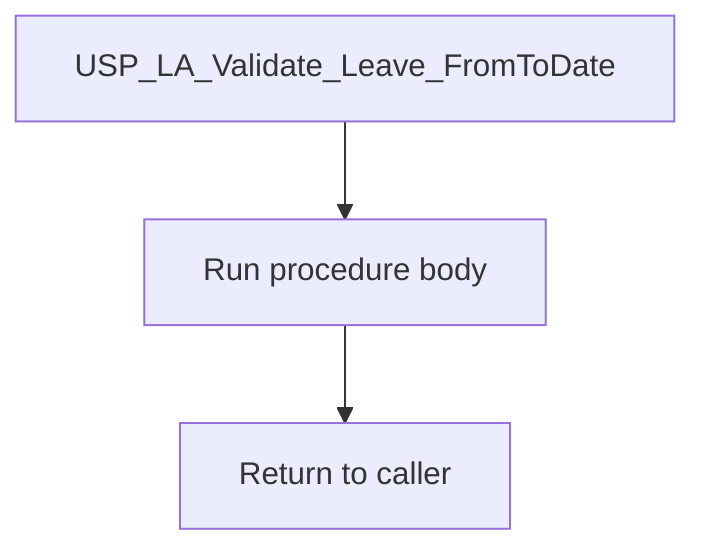

# USP_LA_Validate_Leave_FromToDate

## What it does

Validates leave from/to dates against DOJ, active employment, and leave-type date rules before apply.

## Parameters

| Name | Direction | What it is for |
|---|---|---|
| `@Employeeid` | in | Employee |
| `@Employerid` | in | Employer |
| `@LeaveCode` | in | Leave code |
| `@Fromdate` | in | From |
| `@ToDate` | in | To |

## Call sequence

Calls no other procedures or functions.

## Callers

| Object | Kind | Page |
|---|---|---|
| `USP_LA_ValidateLeaveRequest` | procedure | [USP_LA_ValidateLeaveRequest](/docs/database/hrms/USP_LA_ValidateLeaveRequest) |

## Nested

Calls no other procedures or functions.

## Steps

1. Load employee DOJ/active.
2. Apply leave-type from/to constraints.
3. Return IsValid and Message.

## Tables

| Table | Read or write |
|---|---|
| `TEmployee` | read |
| `TLeaveTypeMaster` | read |

## Flow

