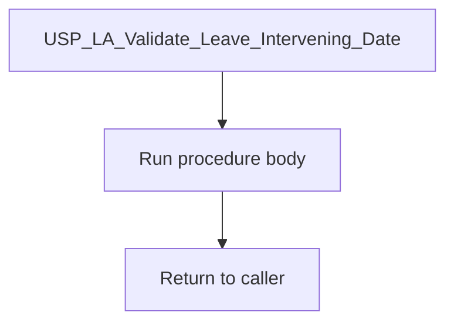

# USP_LA_Validate_Leave_Intervening_Date

## What it does

Computes and validates intervening weekly-off / holiday bridging around a leave range using leave-type intervening options and thresholds.

## Parameters

| Name | Direction | What it is for |
|---|---|---|
| `@Employeeid` | in | Employee plus leave range/intervening inputs on live script |

## Call sequence

Calls no other procedures or functions.

## Callers

| Object | Kind | Page |
|---|---|---|
| `USP_LA_ValidateLeaveRequest` | procedure | [USP_LA_ValidateLeaveRequest](/docs/database/hrms/USP_LA_ValidateLeaveRequest) |

## Nested

Calls no other procedures or functions.

## Steps

1. Read intervening option flags from leave type.
2. Walk before/after chains of WO/Holiday.
3. Return intervening from/to and IsIntervening.

## Tables

| Table | Read or write |
|---|---|
| `TLeaveTypeMaster` | read |
| `calendar / attendance sources` | read |

## Flow

