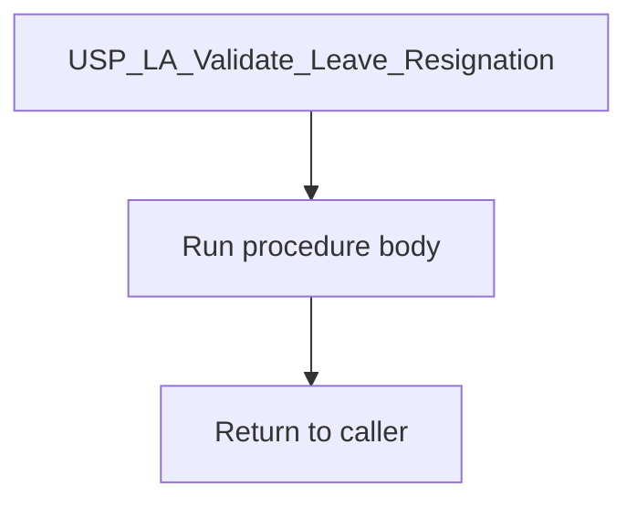

# USP_LA_Validate_Leave_Resignation

## What it does

Blocks or allows leave inside notice/exit windows based on leave-type notice-period rules and resignation dates.

## Parameters

| Name | Direction | What it is for |
|---|---|---|
| `@Employeeid` | in | Employee |
| `@EmployerId` | in | Employer |
| `@LeaveCode` | in | Leave code |
| `@Fromdate` | in | From |
| `@ToDate` | in | To |

## Call sequence

Calls no other procedures or functions.

## Callers

| Object | Kind | Page |
|---|---|---|
| `USP_LA_ValidateLeaveRequest` | procedure | [USP_LA_ValidateLeaveRequest](/docs/database/hrms/USP_LA_ValidateLeaveRequest) |

## Nested

Calls no other procedures or functions.

## Steps

1. Read IsApplyLeavesInNoticePeriod and related limits.
2. Compare request dates to resignation window.
3. Return validity message when blocked.

## Tables

| Table | Read or write |
|---|---|
| `TLeaveTypeMaster` | read |
| `resignation detail tables` | read |

## Flow

