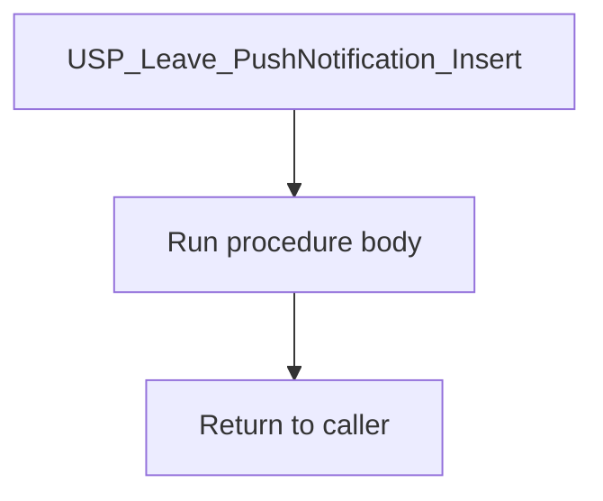

# USP_Leave_PushNotification_Insert

## What it does

Push-notification helper invoked from leave insert and pullback scripts. Live CREATE script was not found under HRMS-DATABASE/HRMS/STOREPROCEDURE during this analysis.

## Parameters

| Name | Direction | What it is for |
|---|---|---|
| `(unknown)` | in | See callers; script missing from repo scan |

## Call sequence

Calls no other procedures or functions.

## Callers

| Object | Kind | Page |
|---|---|---|
| `USP_LA_InsertLeaveRequestDetails` | procedure | [USP_LA_InsertLeaveRequestDetails](/docs/database/hrms/USP_LA_InsertLeaveRequestDetails) |
| `SP_LA_UpdateLeavePullBack` | procedure | [SP_LA_UpdateLeavePullBack](/docs/database/hrms/SP_LA_UpdateLeavePullBack) |

## Nested

Calls no other procedures or functions.

## Steps

1. Called from USP_LA_InsertLeaveRequestDetails and SP_LA_UpdateLeavePullBack.
2. Script path not located in STOREPROCEDURE at analysis time.

## Tables

| Table | Read or write |
|---|---|
| `(unknown)` | — |

## Unresolved calls

CREATE script not found under `HRMS-DATABASE/HRMS/STOREPROCEDURE` during analysis; do not invent parameters.

## Flow

