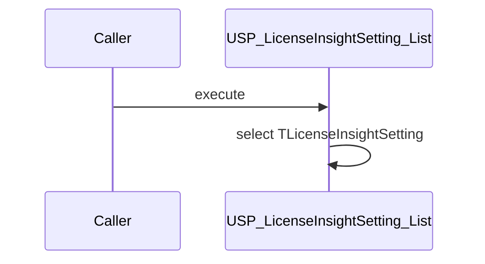
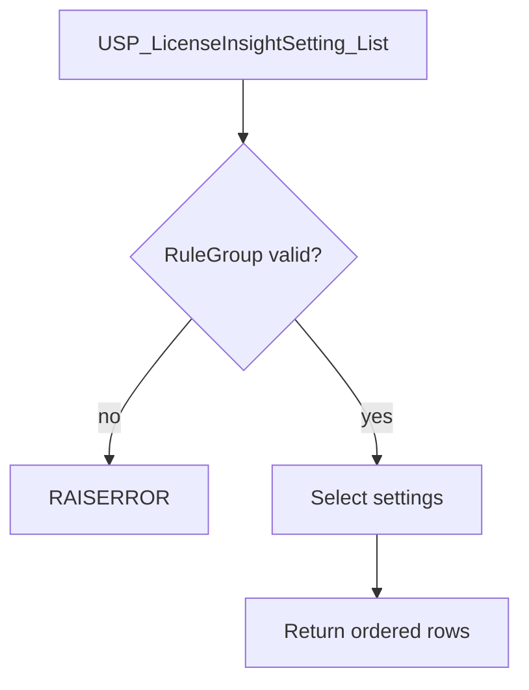

# USP_LicenseInsightSetting_List

## What it does

Reads AI insight configuration rows from `TLicenseInsightSetting` for the Insight Configuration screen and for dashboard callers that need the latest saved windows/thresholds. Optional `@RuleGroup` filters to `Usage` or `Subscription`; null returns both tabs ordered by `DisplaySort`. Also returns computed `IsModified` and `DecimalPlaces`.

On the Customer License Dashboard, the insight-cards and insight-detail services call this with `Subscription` before executing the card/detail procedures.

## Parameters

| Name | Direction | What it is for |
|---|---|---|
| `@RuleGroup` | in | `Usage`, `Subscription`, or null for both |

## Call sequence

Calls no other procedures or functions.

## Callers

| Object | Kind | Page |
|---|---|---|
| `LicenseInsightSettingDAL.list` | app | [Customer License Dashboard](/docs/guides/customer-license/customer-license-dashboard) (cards/detail path); also Insight Configuration |

## Nested

None.

## Steps

1. Reject unknown `@RuleGroup` values with `RAISERROR`.
2. Select setting metadata and values, optionally filtered by rule group.
3. Order by `DisplaySort`.

## Tables

| Table | Read or write |
|---|---|
| `dbo.TLicenseInsightSetting` | read |

## Unresolved calls

None.

## Flow

