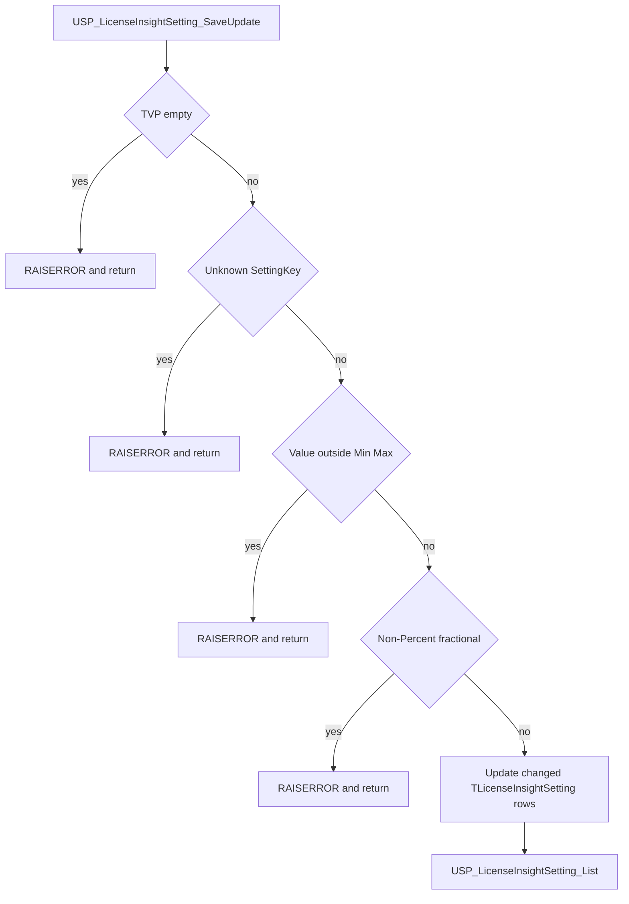

# USP_LicenseInsightSetting_SaveUpdate

## What it does

Persists edited AI insight rules from a table-valued parameter. It rejects an empty TVP, unknown keys, values outside each rule’s min/max, and fractional values on non-Percent rules, then updates only rows whose `SettingValue` actually changed (so unchanged rows keep their audit stamp). After the update it re-runs `USP_LicenseInsightSetting_List` with no `@RuleGroup` filter.

`SET XACT_ABORT ON` is set so a runtime error rolls the batch back. Validation failures use `RAISERROR` and `RETURN` before the update.

## Parameters

| Name | Direction | What it is for |
|---|---|---|
| `@Settings` | in | Readonly `dbo.UDT_LicenseInsightSetting` TVP (`SettingKey`, `SettingValue`) |
| `@UpdatedBy` | in | Employee id written to `UpdatedBy` on changed rows |

## Call sequence

1. `USP_LicenseInsightSetting_List` (no arguments) after a successful update.

## Callers

No other procedure or function calls this object.

`LicenseInsightSettingDAL.saveUpdate` executes it from Dashboard Insights Configuration Save. That caller is application code. The DAL does not consume the List result set this procedure returns.

## Nested

| Object | When |
|---|---|
| [USP_LicenseInsightSetting_List](/docs/database/hrms/USP_LicenseInsightSetting_List) | After changed rows are updated |

## Steps

1. When `@Settings` has no rows, raise an error and return (`USP_LicenseInsightSetting_SaveUpdate.sql`).
2. If any TVP `SettingKey` is missing from `TLicenseInsightSetting`, raise an unknown-key error and return.
3. If any supplied value is outside that rule’s `MinValue`/`MaxValue`, raise a range error naming `DisplayName` and return.
4. If any non-Percent rule has a non-integer value, raise a whole-number error and return.
5. Update `SettingValue`, `UpdatedBy`, and `UpdatedWhen` on matching rows where the value changed.
6. Execute `USP_LicenseInsightSetting_List` with no `@RuleGroup` so both tabs are returned.

## Tables

| Table | Read or write |
|---|---|
| `TLicenseInsightSetting` | read and write |
| `UDT_LicenseInsightSetting` (TVP) | read |

## Unresolved calls

None.

## Flow

