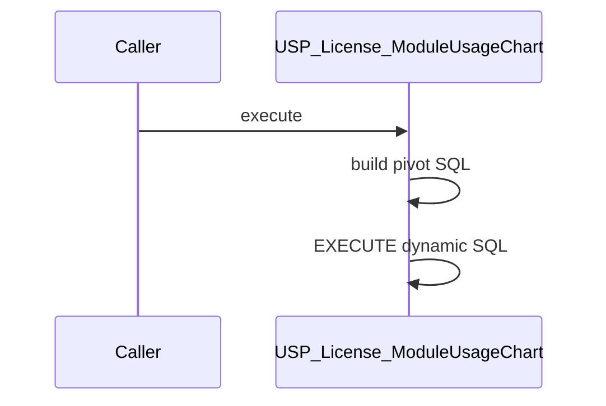
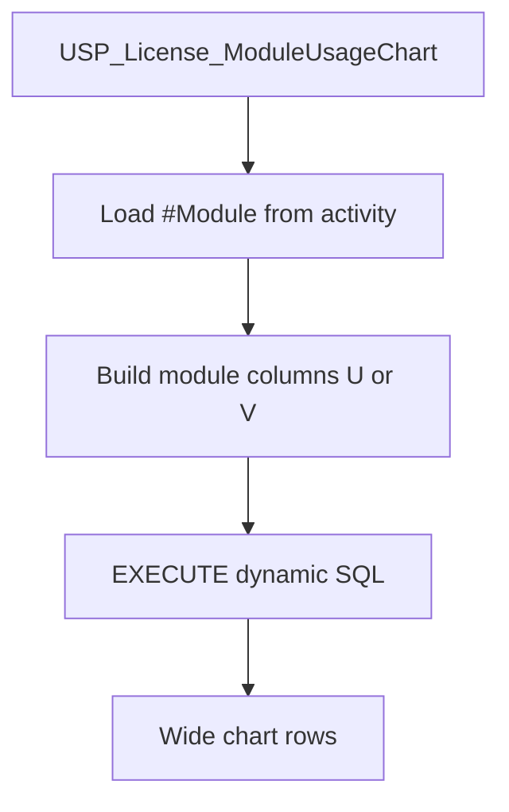

# USP_License_ModuleUsageChart

## What it does

Pivots module usage into a wide chart result for the Customer License Dashboard Module Usage Analytics chart view. Loads matching activity into `#Module`, then builds dynamic SQL that adds one column per distinct module: either distinct employee counts (`@ReportType = 'U'`) or visit counts (`V`). The constructed statement is run with `EXECUTE(@SQL)`.

## Parameters

| Name | Direction | What it is for |
|---|---|---|
| `@ReportType` | in | `U` unique users or `V` total visits |
| `@FromDate` | in | Range start |
| `@ToDate` | in | Range end |
| `@EmployerIDs` | in | Comma-separated employer ids |

## Call sequence

Calls no other procedures or functions (only dynamic SQL).

## Callers

| Object | Kind | Page |
|---|---|---|
| `dashBoardDAL.GetModuleUsageAnalyticschartWise` | app | [Customer License Dashboard](/docs/guides/customer-license/customer-license-dashboard) |

## Nested

None.

## Steps

1. Populate `#Module` from `TActivityLog` for the employers and date window.
2. Concatenate one pivoted column expression per distinct `Module`.
3. Build a SELECT over `TEmployerDetails` joined to the employer id list.
4. `EXECUTE(@SQL)` and return the wide result set.

## Tables

| Table | Read or write |
|---|---|
| `dbo.TActivityLog` | read |
| `dbo.TActivityLogTypes` | read |
| `dbo.TEmployeeInfo` | read |
| `dbo.TEmployerDetails` | read |

## Unresolved calls

None beyond the dynamic `EXECUTE(@SQL)` batch.

## Flow

