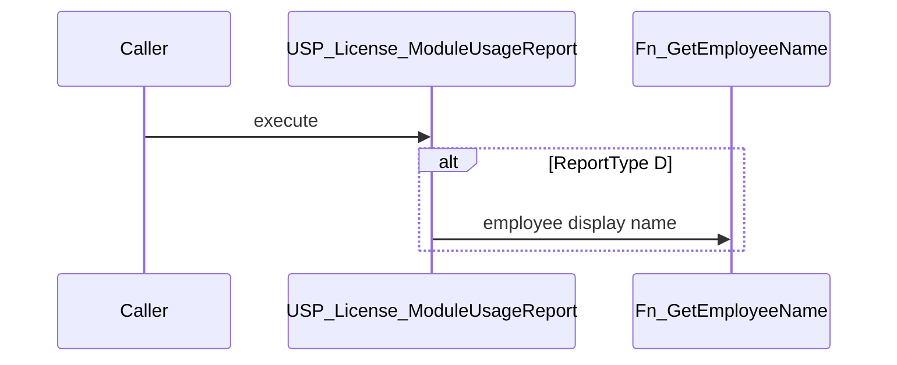
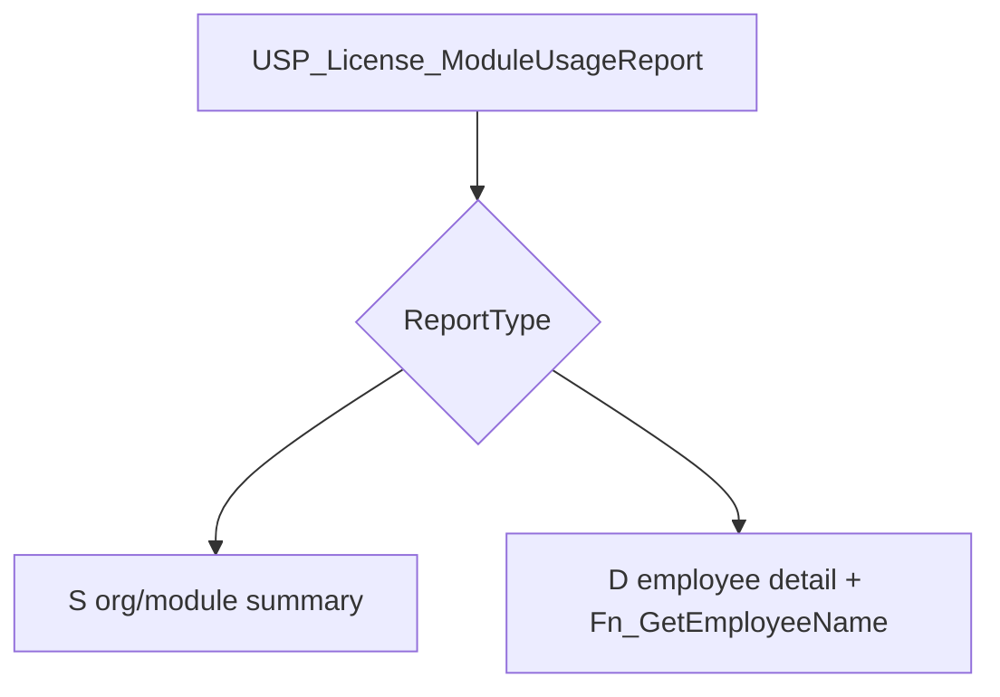

# USP_License_ModuleUsageReport

## What it does

Legacy module-usage report used by the dashboard for employee-level drill-down (`@ReportType = 'D'`). Summary mode `S` returns organisation/module unique users, visits, and last usage. Detail mode `D` returns per-employee visits for one `@Module`, formatting names with `fn_getemployeename`. The Customer License Dashboard insight grid no longer uses mode `S` (it calls `USP_License_ModuleUsage_Insights` instead) but still calls mode `D` from the eye icon.

## Parameters

| Name | Direction | What it is for |
|---|---|---|
| `@ReportType` | in | `S` summary or `D` employee detail |
| `@FromDate` | in | Range start |
| `@ToDate` | in | Range end |
| `@EmployerIDs` | in | Comma-separated employer ids |
| `@Module` | in | Required for `D`; module name filter |

## Call sequence

## Callers

| Object | Kind | Page |
|---|---|---|
| `dashBoardDAL.GetModuleUsageAnalyticsgridWise` | app | [Customer License Dashboard](/docs/guides/customer-license/customer-license-dashboard) |

## Nested

| Object | Kind | Page |
|---|---|---|
| `Fn_GetEmployeeName` (`fn_getemployeename`) | function | [Fn_GetEmployeeName](/docs/database/hrms/Fn_GetEmployeeName) |

## Steps

1. For `S`, group activity by employer and module within the date window.
2. For `D`, filter to `@Module` and group by employee, joining `TTitle` for designation and calling `fn_getemployeename`.

## Tables

| Table | Read or write |
|---|---|
| `dbo.TActivityLog` | read |
| `dbo.TActivityLogTypes` | read |
| `dbo.TEmployeeInfo` | read |
| `dbo.TEmployerDetails` | read (`S` only) |
| `dbo.TTitle` | read (`D` only) |

## Unresolved calls

None.

## Flow

