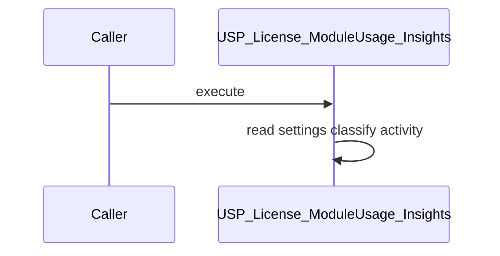
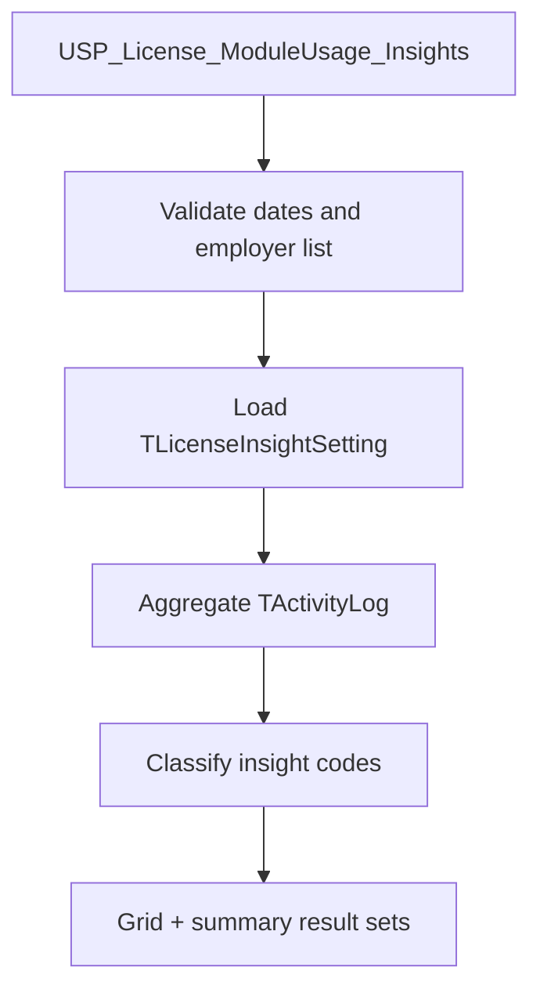

# USP_License_ModuleUsage_Insights

## What it does

Powers the Module Usage Analytics grid on the Customer License Dashboard with one AI insight per organisation/module row. Scans `TActivityLog` for the selected employers over the current range plus an equal-length baseline, classifies each module as INACTIVE / DROP / SPIKE / LOW_ENGAGEMENT / STABLE using thresholds from `TLicenseInsightSetting`, and returns two result sets: the grid rows and a summary count strip.

## Parameters

| Name | Direction | What it is for |
|---|---|---|
| `@FromDate` | in | Inclusive range start |
| `@ToDate` | in | Inclusive range end |
| `@EmployerIDs` | in | Comma-separated employer ids |

## Call sequence

Calls no other procedures or functions.

## Callers

| Object | Kind | Page |
|---|---|---|
| `ModuleUsageInsightsDAL.list` | app | [Customer License Dashboard](/docs/guides/customer-license/customer-license-dashboard) |

## Nested

None.

## Steps

1. Reject inverted date ranges.
2. Split `@EmployerIDs` into `#Emp`; exit quietly when empty.
3. Load usage thresholds from `TLicenseInsightSetting`.
4. Aggregate current and baseline visits/users from `TActivityLog` / `TActivityLogTypes`.
5. Classify rows with precedence INACTIVE → DROP → SPIKE → LOW_ENGAGEMENT → STABLE.
6. Return grid result set, then summary counts.

## Tables

| Table | Read or write |
|---|---|
| `dbo.TLicenseInsightSetting` | read |
| `dbo.TActivityLog` | read |
| `dbo.TActivityLogTypes` | read |
| `dbo.TEmployeeInfo` | read |
| `dbo.TEmployerDetails` | read |

## Unresolved calls

None.

## Flow

