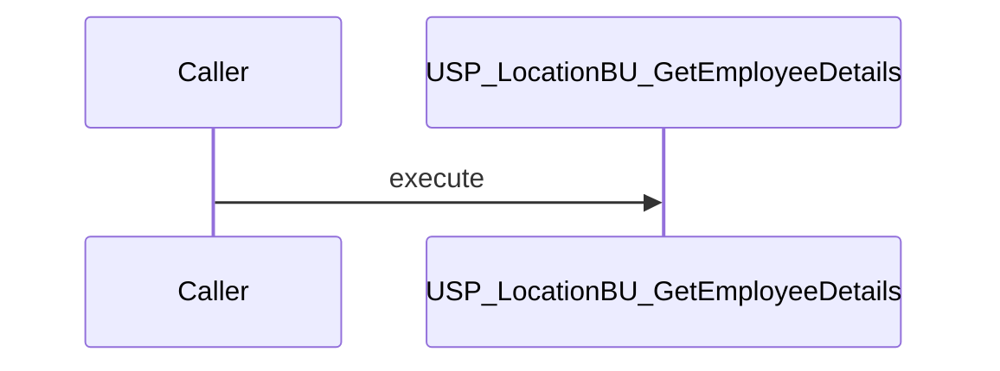
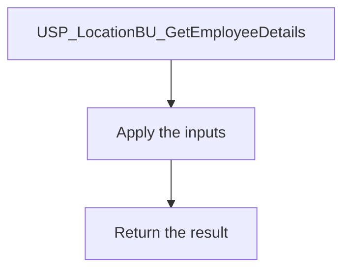

# USP_LocationBU_GetEmployeeDetails

## What it does

Called from the Home dashboard path. It reads TUserEmployee, TUsers, TUserPagesMapping, TRolePagesMapping, TEmployee and returns the result to its caller.

## Parameters

| Name | Direction | What it is for |
|---|---|---|
| `@EmployeeId` | in | Employee the Home screen is loading or acting for (`INT`) |
| `@EmployerId` | in | Employer that owns the data (`INT`) |

## Call sequence

## Callers

| Object | Kind | Page |
|---|---|---|
| `SP_Get_MyTeamCard_DirectReportees` | procedure | [SP_Get_MyTeamCard_DirectReportees](/docs/database/hrms/SP_Get_MyTeamCard_DirectReportees) |

## Nested

This object does not execute another procedure or user-defined function.

## Steps

In `HRMS-DATABASE/HRMS/STOREPROCEDURE/USP_LocationBU_GetEmployeeDetails.sql`:

1. Read `TUserEmployee`, `TUsers`, `TUserPagesMapping`, `TRolePagesMapping`, `TEmployee`, `TEmployeeInfo`, `TLocation`, `TOrgHierarchyDetails`.
2. Return the result set to the caller.

## Tables

| Table | Read or write |
|---|---|
| `TUserEmployee` | read |
| `TUsers` | read |
| `TUserPagesMapping` | read |
| `TRolePagesMapping` | read |
| `TEmployee` | read |
| `TEmployeeInfo` | read |
| `TLocation` | read |
| `TOrgHierarchyDetails` | read |

## Unresolved calls

This script builds or executes dynamic SQL (`sp_executesql` or `EXEC(@variable)`). The procedure name is not fixed in the script.

## Flow

