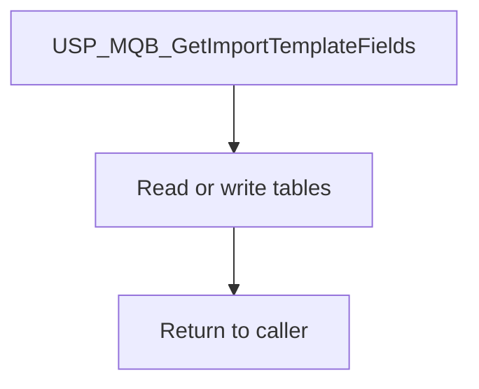

# USP_MQB_GetImportTemplateFields

## What it does

SP to get Template Fields

## Parameters

| Name | Direction | What it is for |
|---|---|---|
| `@ModuleId` | in | INT |

## Call sequence

Calls no other procedures or functions.

## Callers

No other procedure or function in the Master Question Bank direct set calls this object.

Application code may call it through `masterQuestionBankDAL`.

## Nested

Calls no other procedures or functions.

## Steps

1. Selects and returns one or more result sets for the caller.

## Tables

| Table | Read or write |
|---|---|
| `TQuestion_ImportTemplateFields` | read |

## Flow

