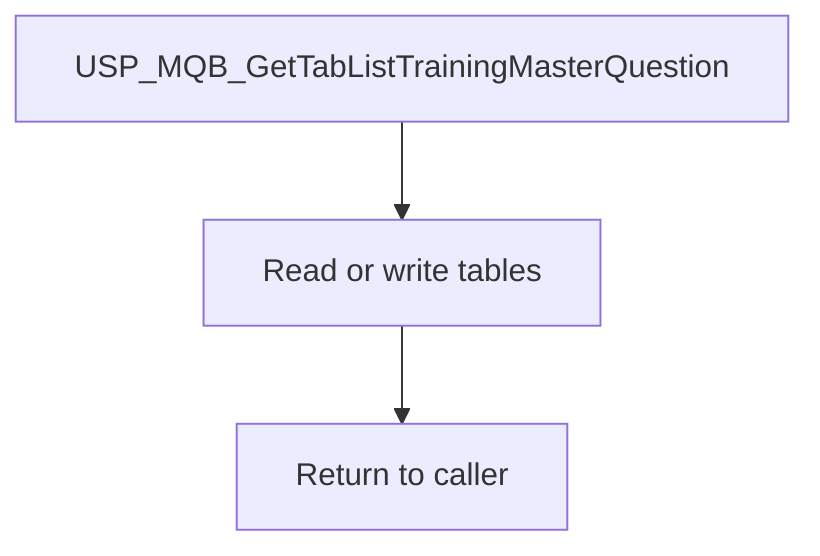

# USP_MQB_GetTabListTrainingMasterQuestion

## What it does

Returns editable tab permissions for Master Question Bank menu id 113.

## Parameters

| Name | Direction | What it is for |
|---|---|---|
| `@employerId` | in | INT |
| `@employeeId` | in | INT |

## Call sequence

Calls no other procedures or functions.

## Callers

No other procedure or function in the Master Question Bank direct set calls this object.

Application code may call it through `masterQuestionBankDAL`.

## Nested

Calls no other procedures or functions.

## Steps

1. Selects and returns one or more result sets for the caller.

## Tables

| Table | Read or write |
|---|---|
| `TUsers` | read |
| `TRoleTabDetails` | read |
| `TUserTabDetails` | read |
| `TUserEmployee` | read |
| `TEmployee` | read |
| `TTabDetails` | read |

## Flow

