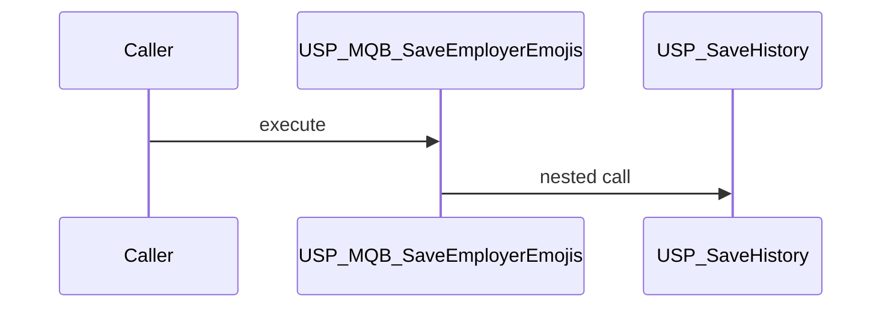
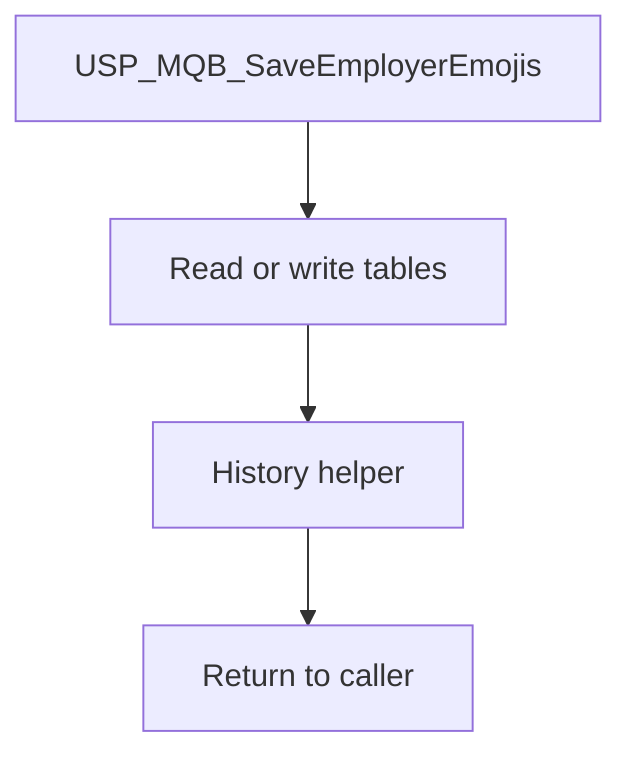

# USP_MQB_SaveEmployerEmojis

## What it does

Saves employer emoji rating defaults and history.

## Parameters

| Name | Direction | What it is for |
|---|---|---|
| `@EmployerId` | in | INT |
| `@Emojis` | in | NVARCHAR(250) |
| `@CreatedBy` | in | INT |

## Call sequence

## Callers

No other procedure or function in the Master Question Bank direct set calls this object.

Application code may call it through `masterQuestionBankDAL`.

## Nested

| Object | Kind | When | Page |
|---|---|---|---|
| `USP_SaveHistory` | procedure | on the script path that reaches this call | No page yet |

## Steps

1. Inserts into the target table(s) listed under Tables.
2. Deletes matching rows when the script path removes options or related data.
3. Calls history helper(s) after the primary write.

## Tables

| Table | Read or write |
|---|---|
| `TEmployerEmojiRating` | read and write |
| `STRING_SPLIT` | read |

## Flow

