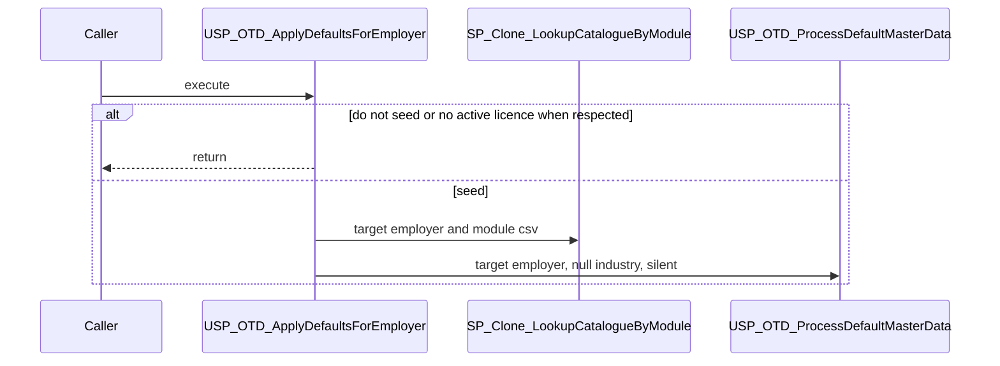
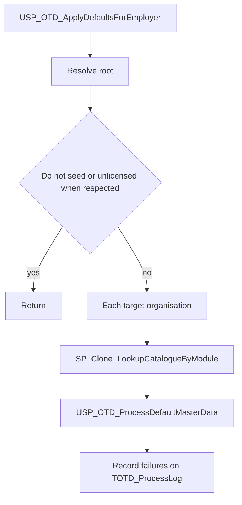

# USP_OTD_ApplyDefaultsForEmployer

## What it does

Decides which organisations to seed and which licensed modules to use, then calls the lookup-catalogue clone and the default-master processor. Add Organization calls it with children excluded, do-not-seed respected, and silent output. It does not raise. Failures are written to TOTD_ProcessLog and returned in @FailureMessage.

## Parameters

| Name | Direction | What it is for |
|---|---|---|
| `@EmployerId` | in | Organisation to seed |
| `@ModuleIds` | in | Module id csv. Null uses the root's active TEmployerModule rows |
| `@IncludeChildren` | in | 1 also seeds every organisation under this one. Add Organization passes 0 |
| `@RespectDoNotSeed` | in | 1 skips when this organisation or its root is marked do-not-seed, and skips a root with no active licence |
| `@DoNotSeed` | in | 1 records the do-not-seed marker and stops |
| `@Silent` | in | 1 returns no result sets. Default 1 |
| `@FailureMessage` | out | Combined failure text. Null when nothing failed |

## Call sequence

## Callers

Procedures and functions that call this object.

No other procedure or function calls this object.

## Nested

| Object | Kind | When | Page |
|---|---|---|
| `SP_Clone_LookupCatalogueByModule` | procedure | module list is not blank, once per target | [SP_Clone_LookupCatalogueByModule](/docs/database/hrms/SP_Clone_LookupCatalogueByModule) |
| `USP_OTD_ProcessDefaultMasterData` | procedure | once per target, with industry left null and Silent 1 | [USP_OTD_ProcessDefaultMasterData](/docs/database/hrms/USP_OTD_ProcessDefaultMasterData) |

## Steps

1. Clear @FailureMessage. Return when @EmployerId is null or not positive, or when the employer row does not exist.

2. Resolve the root with ISNULL(RootEmployerId, EmployerId).

3. When @DoNotSeed is 1, insert one TOTD_ProcessLog marker with IsDoNotSeed 1 if that marker is missing, then return.

4. When @RespectDoNotSeed is 1, return if this employer or its root already has IsDoNotSeed 1, or if the root has no Active TLicence.

5. When @ModuleIds is blank, fill it from distinct active HrmsModuleID values on the root's TEmployerModule rows.

6. Put this employer in the target list. When @IncludeChildren is 1, also add non-deleted organisations whose root is this employer.

7. Delete do-not-seed markers for the targets, then for each target execute SP_Clone_LookupCatalogueByModule when modules exist, and always execute USP_OTD_ProcessDefaultMasterData with IndustryTypeId null and Silent 1. Catch failures into @FailureMessage and TOTD_ProcessLog.

8. When @Silent is 0, return the log rows written after the high-water mark, then a summary row of succeeded, failed, skipped, and organisations processed.

## Tables

| Table | Read or write |
|---|---|
| `TEmployerDetails` | read |
| `TOTD_ProcessLog` | read and write |
| `TLicence` | read |
| `TEmployerModule` | read |

## Flow

