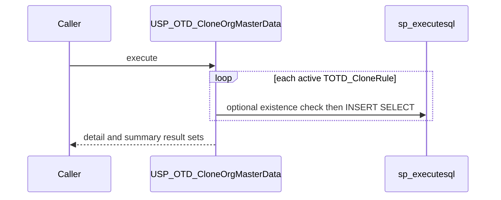
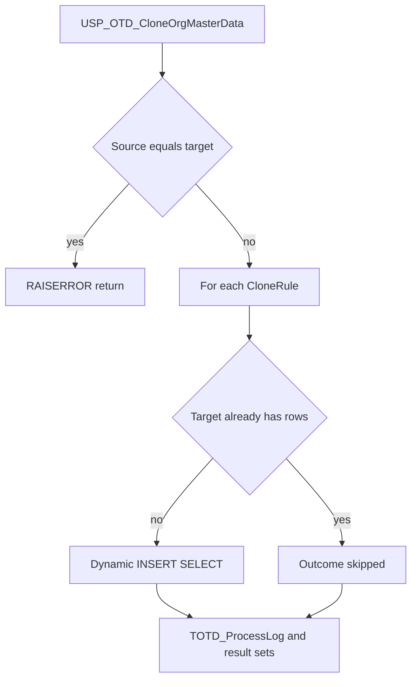

# USP_OTD_CloneOrgMasterData

## What it does

Clones master-data sections from a source employer into a target employer using active `TOTD_CloneRule` rows (optionally filtered by module CSV). Skips a rule when the target table already has rows for the target employer. Logs each rule to `TOTD_ProcessLog` and returns a detail grid plus a summary where `Succeeded` is rows copied.

## Parameters

| Name | Direction | What it is for |
|---|---|---|
| `@SourceEmployerId` | in | Organisation to copy from |
| `@TargetEmployerId` | in | Organisation to copy into |
| `@ModuleIds` | in | Optional CSV of module ids; null/empty means no module filter |

## Call sequence

## Callers

No other procedure calls this object. `dashBoardDAL.SeedMasterData` executes it when HRMS Licenses seed choice is `parent` or `specific`.

## Nested

| Object | Kind | When | Page |
|---|---|---|---|
| `sp_executesql` | system | existence check and dynamic INSERT SELECT per rule | n/a |

## Steps

1. Raise and return when source and target are the same employer.
2. Parse optional module CSV into a filter table.
3. Cursor active `TOTD_CloneRule` rows in display order (module filter applied).
4. For each rule, if the target table has an `EmployerId`/`RootEmployerid` column and already has rows for the target, mark skipped.
5. Otherwise run the rule's dynamic INSERT SELECT; mark copied, nosource (0 rows), or failed.
6. Insert process log rows, return detail grid, then summary (`Succeeded`, `Failed`, `Skipped`, `NoSource`, `RulesCopied`, `ProcessStatus`).

## Tables

| Table | Read or write |
|---|---|
| `dbo.TOTD_CloneRule` | read |
| `dbo.TOTD_ProcessLog` | write |
| Dynamic target tables from rules | read source, write target |

## Unresolved calls

None beyond `sys.sp_executesql` / `sp_executesql`.

## Flow

