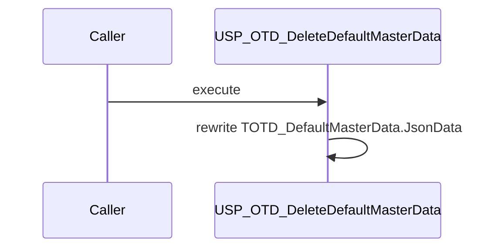
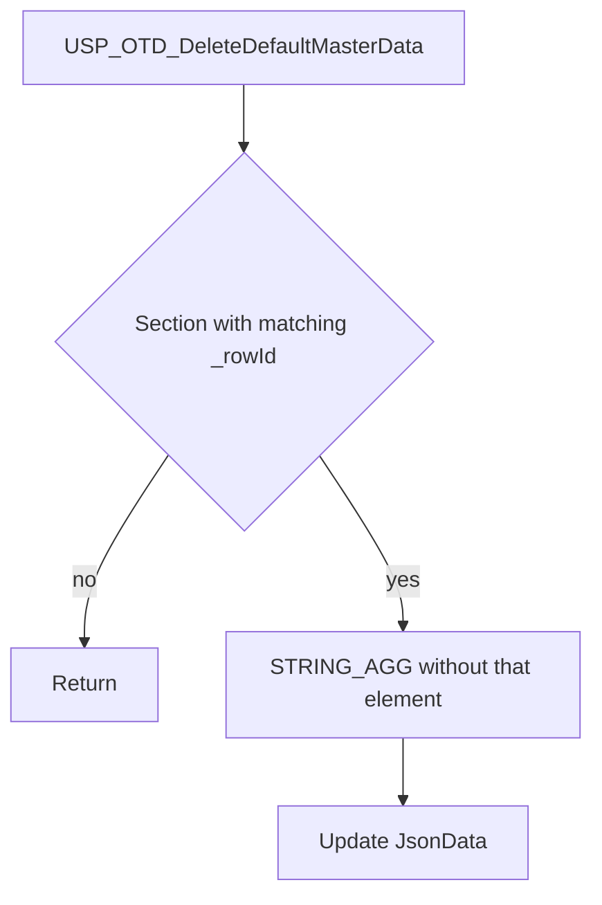

# USP_OTD_DeleteDefaultMasterData

## What it does

Hard-removes the one default master record whose `_rowId` equals `@DefaultMasterDataId` from the owning section's JSON array. `_rowId` is globally unique via the sequence, so the single-argument signature resolves to at most one element. Unknown id is a no-op (same as the prior soft-delete behaviour for missing ids).

## Parameters

| Name | Direction | What it is for |
|---|---|---|
| `@DefaultMasterDataId` | in | `_rowId` inside a section's `JsonData` array |
| `@UserId` | in | UpdatedBy on the section row |

## Call sequence

Calls no other procedures or functions.

## Callers

Procedures and functions that call this object.

No other procedure or function calls this object. Application caller: Core Node `ClientOnboardingDAL.deleteDefaultMasterData` via `DELETE /api/clientonboard2/otd/defaultMasterData/:id`.

## Nested

Calls no other procedures or functions.

## Steps

1. Find the active section row whose JSON array contains an element with matching `_rowId`. Return if none.

2. Rebuild the array without that element (elements lacking `_rowId` survive).

3. Update `JsonData`, `UpdatedBy`, and `UpdatedDate` on that section row.

## Tables

| Table | Read or write |
|---|---|
| `TOTD_DefaultMasterData` | read/write |

## Unresolved calls

None.

## Flow

