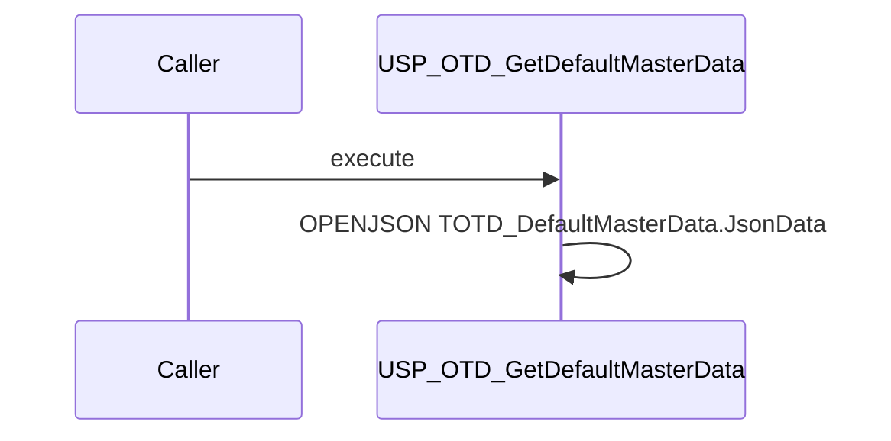
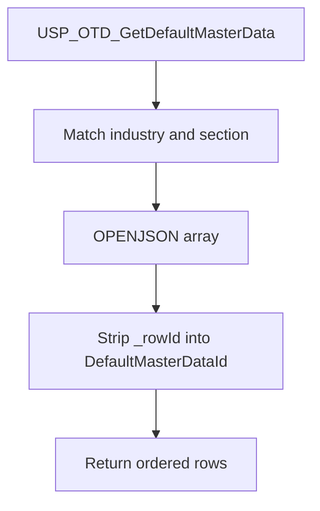

# USP_OTD_GetDefaultMasterData

## What it does

Returns one result row per default master record for an industry and section. It `OPENJSON`-explodes the stored JSON array on `TOTD_DefaultMasterData`, surfaces each element's `_rowId` as `DefaultMasterDataId`, and strips `_rowId` from the returned `JsonData` payload. `@IndustryTypeId` 0 means industry-independent (Common) rows.

## Parameters

| Name | Direction | What it is for |
|---|---|---|
| `@IndustryTypeId` | in | Industry owner. Null coerced to 0 (Common). Default 0 |
| `@SectionId` | in | Process section id |

## Call sequence

Calls no other procedures or functions.

## Callers

Procedures and functions that call this object.

No other procedure or function calls this object. Application caller: Core Node `ClientOnboardingDAL.getDefaultMasterData` via `GET /api/clientonboard2/otd/defaultMasterData`.

## Nested

Calls no other procedures or functions.

## Steps

1. Read active `TOTD_DefaultMasterData` for the industry and section where `JsonData` is valid JSON.

2. Cross-apply `OPENJSON` on the array. Cast each `_rowId` to `DefaultMasterDataId` and return the element with `_rowId` removed via `JSON_MODIFY`.

3. Order by array index (`key`).

## Tables

| Table | Read or write |
|---|---|
| `TOTD_DefaultMasterData` | read |

## Unresolved calls

None.

## Flow

