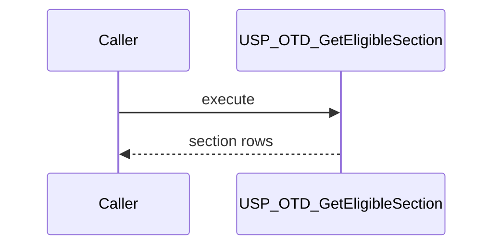
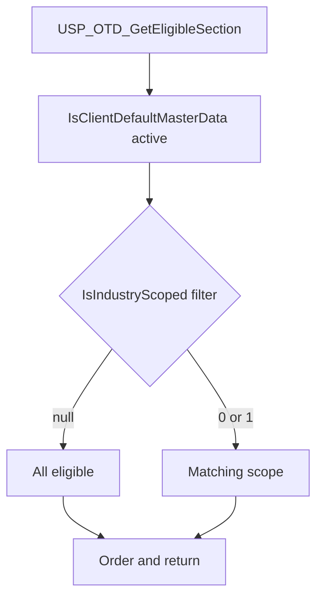

# USP_OTD_GetEligibleSection

## What it does

Returns active process sections flagged `IsClientDefaultMasterData = 1` for the Setup Data Management section picker. Optionally filters to industry-scoped or Common sections via `@IsIndustryScoped`.

## Parameters

| Name | Direction | What it is for |
|---|---|---|
| `@IsIndustryScoped` | in | Null = every eligible section. 0 = Common. 1 = industry-scoped. Default null |

## Call sequence

Calls no other procedures or functions.

## Callers

Procedures and functions that call this object.

No other procedure or function calls this object. App caller: `ClientOnboardingDAL.getEligibleSection`.

## Nested

Calls no other procedures or functions.

## Steps

1. Select SectionID, Section, DisplayOrder, ModuleId, IsIndustryScoped from active `TCOB_ProcessSectionMaster` where `IsClientDefaultMasterData = 1`.

2. When `@IsIndustryScoped` is not null, keep only matching `IsIndustryScoped` rows. Order by DisplayOrder, SectionID.

## Tables

| Table | Read or write |
|---|---|
| `TCOB_ProcessSectionMaster` | read |

## Unresolved calls

None.

## Flow

