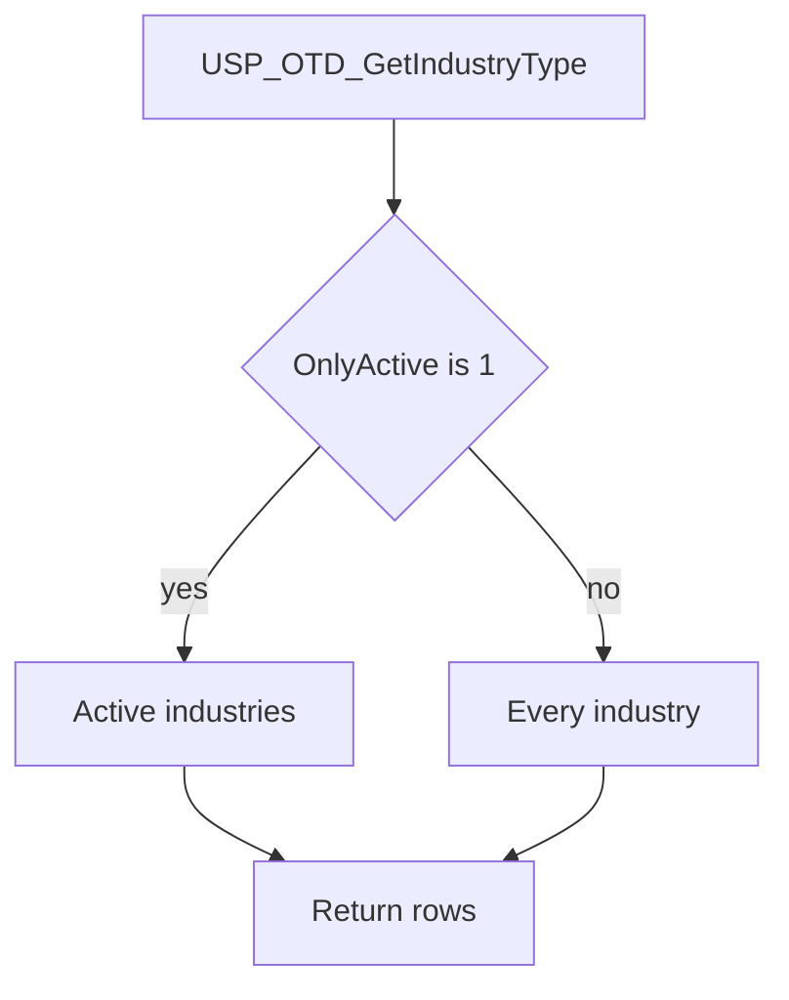

# USP_OTD_GetIndustryType

## What it does

Returns industry types for the Add Organization combo and the industry master. Add Organization calls it with OnlyActive true and IncludeCommon false. IncludeCommon is accepted and ignored.

## Parameters

| Name | Direction | What it is for |
|---|---|---|
| `@IncludeCommon` | in | Kept for older callers. The script does not use it |
| `@OnlyActive` | in | 1 returns active rows. 0 returns every row. Default 1 |

## Call sequence

Calls no other procedures or functions.

## Callers

Procedures and functions that call this object.

No other procedure or function calls this object.

## Nested

Calls no other procedures or functions.

## Steps

1. Select IndustryTypeId, IndustryType, Description, and IsActive from TIndustryType.

2. When @OnlyActive is 1, keep only IsActive rows. Order by IndustryType.

## Tables

| Table | Read or write |
|---|---|
| `TIndustryType` | read |

## Flow

