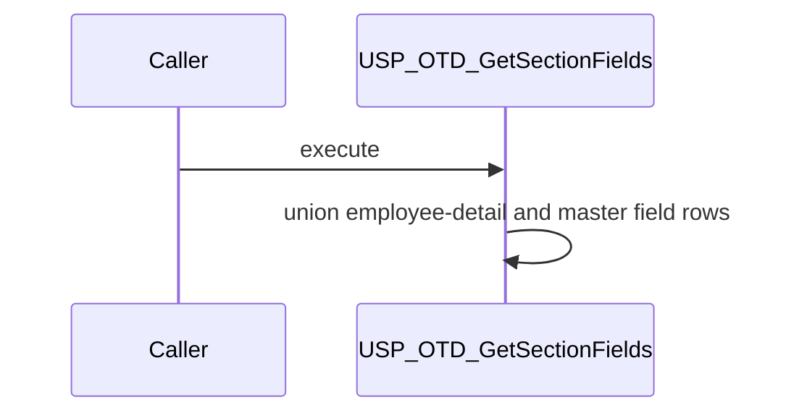
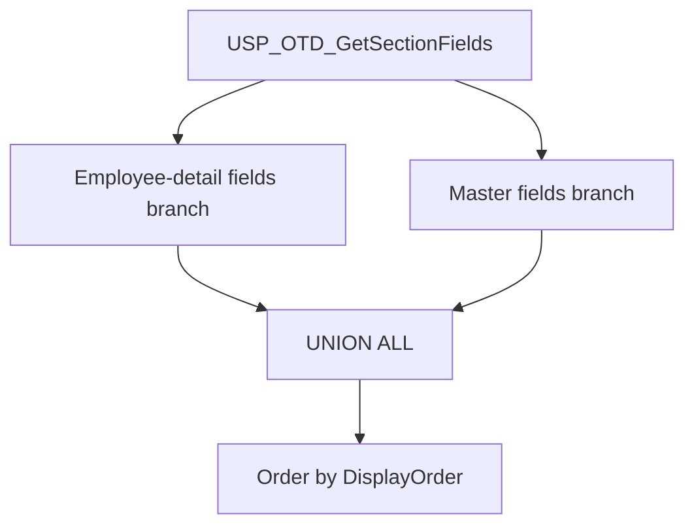

# USP_OTD_GetSectionFields

## What it does

Returns field definitions for one process section so Setup Data Management can render Add/Edit columns and validation. Employee-detail sections read `TCOB_EmployeeDetail_Fields`; master sections read `TCOB_ProcessSectionMaster_Fields`. Both branches join template sheet metadata when present.

## Parameters

| Name | Direction | What it is for |
|---|---|---|
| `@SectionId` | in | `TCOB_ProcessSectionMaster.SectionID` |

## Call sequence

Calls no other procedures or functions.

## Callers

Procedures and functions that call this object.

No other procedure or function calls this object. Application caller: Core Node `ClientOnboardingDAL.getSectionFields` via `GET /api/clientonboard2/otd/sectionFields` (also used by BLL before upsert validation).

## Nested

Calls no other procedures or functions.

## Steps

1. For employee-detail sections, select active `TCOB_EmployeeDetail_Fields` linked through `EmployeeDetailSectionID`, limited to System/Country/segment entities and excluding known identity field names. Country fields keep CountryID 99 only.

2. Union master-section fields from `TCOB_ProcessSectionMaster_Fields` for the same `@SectionId`.

3. Left-join template section and template master for display context. Order by `DisplayOrder`.

## Tables

| Table | Read or write |
|---|---|
| `TCOB_ProcessSectionMaster` | read |
| `TCOB_TemplateSectionMaster` | read |
| `TCOB_TemplateMaster` | read |
| `TCOB_EmployeeDetail_Fields` | read |
| `TCOB_ProcessSectionMaster_Fields` | read |

## Unresolved calls

None.

## Flow

