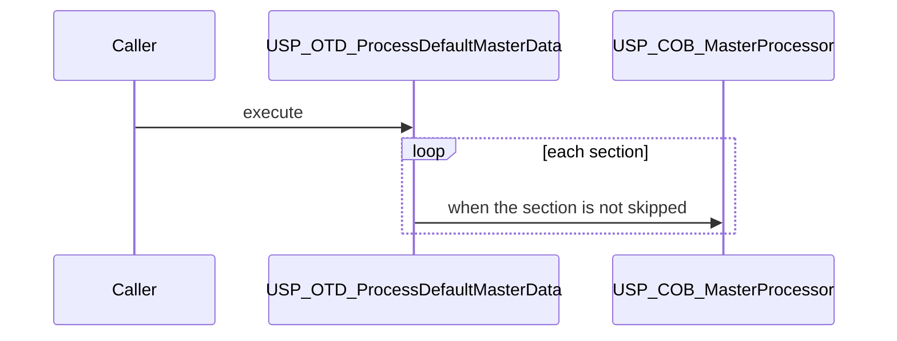
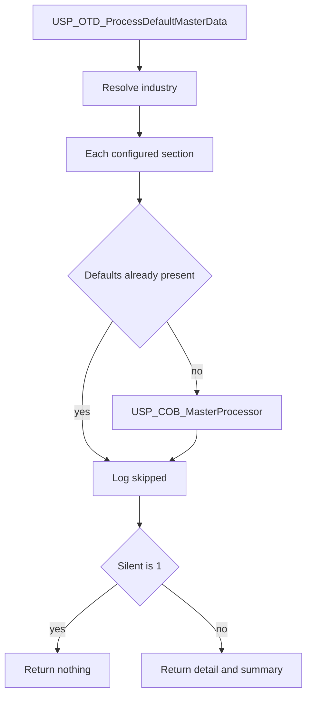

# USP_OTD_ProcessDefaultMasterData

## What it does

Seeds default master data for one employer's industry and for industry-independent sections. A null industry id is read from TEmployerDetails. Sections whose target table already holds the defaults are skipped. Each section that still needs rows is sent to USP_COB_MasterProcessor with source OTD. The run is logged on TOTD_ProcessLog. Add Organization calls it with Silent 1, so it returns no grids.

## Parameters

| Name | Direction | What it is for |
|---|---|---|
| `@EmployerId` | in | Employer to seed |
| `@IndustryTypeId` | in | Industry. Null reads TEmployerDetails.IndustryTypeId |
| `@ModuleIds` | in | Section module filter. Null means all sections |
| `@Silent` | in | 1 returns no result sets. Default 0. Add Organization passes 1 |

## Call sequence

## Callers

Procedures and functions that call this object.

| Object | Kind | Page |
|---|---|---|
| `USP_OTD_ApplyDefaultsForEmployer` | procedure | [USP_OTD_ApplyDefaultsForEmployer](/docs/database/hrms/USP_OTD_ApplyDefaultsForEmployer) |

## Nested

| Object | Kind | When | Page |
|---|---|---|
| `USP_COB_MasterProcessor` | procedure | a section still has default rows to insert | No page yet |

## Steps

1. Resolve the industry from the parameter or from TEmployerDetails. Select the sections to process for that industry and for a null industry, optionally filtered by @ModuleIds.

2. For each section, build a comparison against the target table. Skip the section when every default record is already present, or when the table-level row count is already greater than zero and the per-record comparison was not available.

3. Otherwise execute USP_COB_MasterProcessor with the section batch, a null import session, logged-in employee -1, and source OTD.

4. Insert the run into TOTD_ProcessLog, including skipped sections as processed with a Skipped comment.

5. When @Silent is 0, return the detail and summary grids. Silent 1 returns nothing.

## Tables

| Table | Read or write |
|---|---|
| `TEmployerDetails` | read |
| `TCOB_ProcessSectionMaster` | read |
| `TCOB_ProcessSectionMaster_Fields` | read |
| `TOTD_ProcessLog` | write |

## Unresolved calls

The skip check builds `@CheckSql` and runs it with `sys.sp_executesql`. The target table name comes from section configuration (`@TargetSchema`, `@TargetTable`, `@EmployerColumn`). This page does not guess which table that string names.

## Flow

