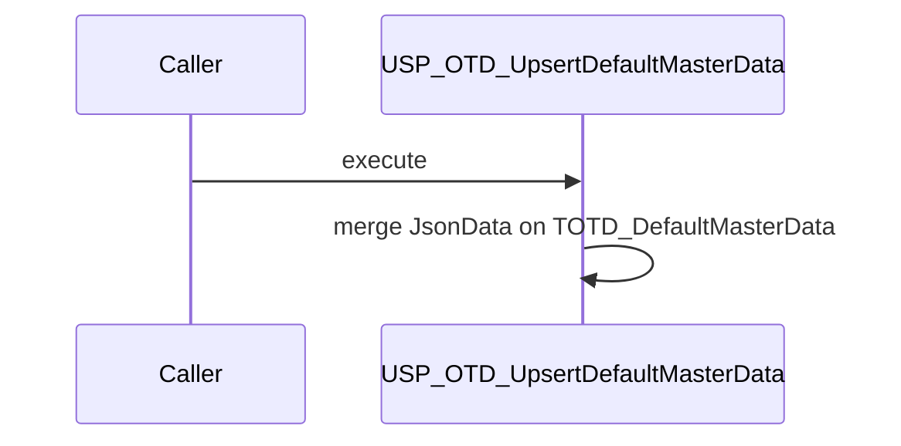
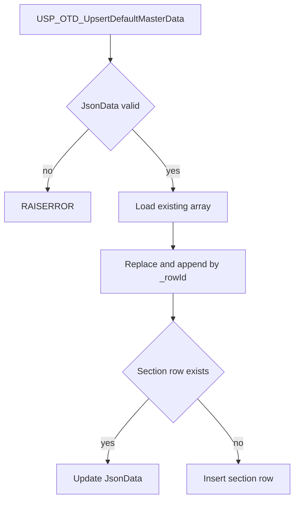

# USP_OTD_UpsertDefaultMasterData

## What it does

Merges posted default rows into one section's JSON array on `TOTD_DefaultMasterData`, keyed on `_rowId` / `DefaultMasterDataId`. Rows not named in the payload are left alone so a one-row save cannot wipe the rest of the section. New rows take ids from `SEQ_TOTD_DefaultMasterDataRowId`. Missing or invalid existing JSON starts from an empty array; a missing section row is inserted.

## Parameters

| Name | Direction | What it is for |
|---|---|---|
| `@IndustryTypeId` | in | Industry owner. Null coerced to 0 (Common). Default 0 |
| `@SectionId` | in | Process section id |
| `@JsonData` | in | `{ "Rows": [ { DefaultMasterDataId?, Data:{...} } ] }` |
| `@UserId` | in | CreatedBy / UpdatedBy |

## Call sequence

Calls no other procedures or functions. Uses sequence `SEQ_TOTD_DefaultMasterDataRowId` for new `_rowId` values.

## Callers

Procedures and functions that call this object.

No other procedure or function calls this object. Application caller: Core Node `ClientOnboardingDAL.upsertDefaultMasterData` via `POST /api/clientonboard2/otd/defaultMasterData` after BLL validation.

## Nested

Calls no other procedures or functions.

## Steps

1. Reject when `@JsonData` is not valid JSON.

2. Load the section's current `JsonData` (or `[]` when missing/corrupt). Parse `$.Rows` into ordinal, optional `DefaultMasterDataId`, and `Data` object.

3. Assign sequence values to rows without `DefaultMasterDataId`. Rebuild the array: replace existing elements whose `_rowId` matches, then append unmatched payload rows.

4. Update the section row, or insert when no row exists for that industry+section.

## Tables

| Table | Read or write |
|---|---|
| `TOTD_DefaultMasterData` | read/write |
| `SEQ_TOTD_DefaultMasterDataRowId` | read (NEXT VALUE) |

## Unresolved calls

None.

## Flow

