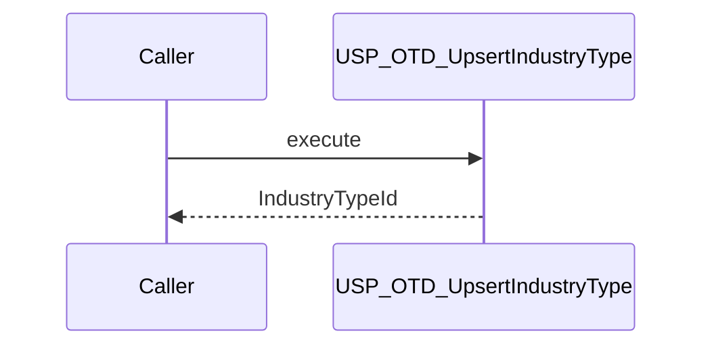
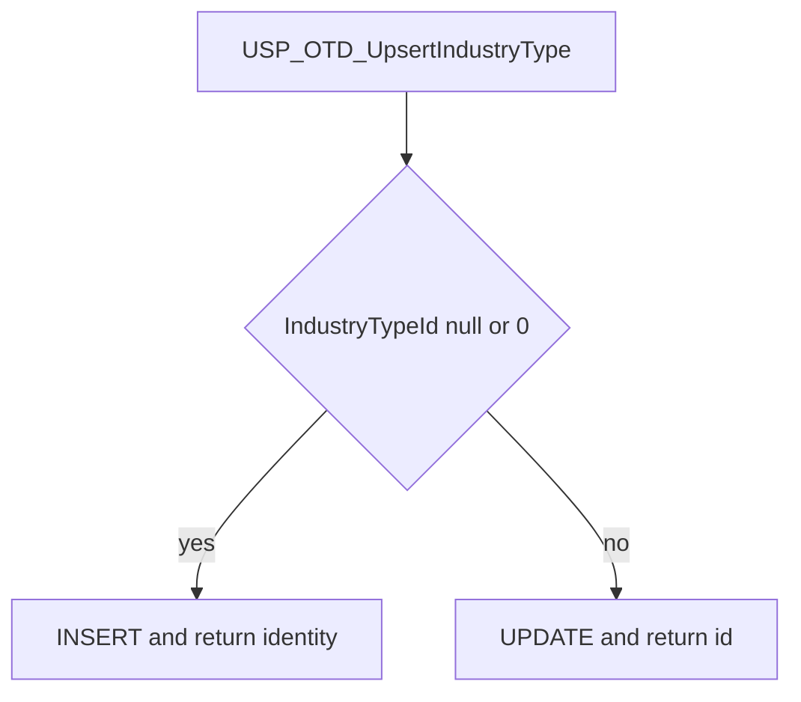

# USP_OTD_UpsertIndustryType

## What it does

Creates or updates a row in `TIndustryType`. Null or 0 `@IndustryTypeId` inserts; otherwise updates by id. Returns the IndustryTypeId. Used by the OTD industry-type API that Screen B and related pickers share.

## Parameters

| Name | Direction | What it is for |
|---|---|---|
| `@IndustryTypeId` | in | Null/0 insert; else update key |
| `@IndustryType` | in | Display name |
| `@Description` | in | Optional description |
| `@IsActive` | in | Active flag. Default 1 |
| `@UserId` | in | CreatedBy or ModifiedBy |

## Call sequence

Calls no other procedures or functions.

## Callers

Procedures and functions that call this object.

No other procedure or function calls this object. App caller: `ClientOnboardingDAL.upsertIndustryType`.

## Nested

Calls no other procedures or functions.

## Steps

1. When `@IndustryTypeId` is null or 0, INSERT into `TIndustryType` and return `SCOPE_IDENTITY()`.

2. Otherwise UPDATE name, description, IsActive, and modified audit columns; return the same id.

## Tables

| Table | Read or write |
|---|---|
| `TIndustryType` | write (insert or update) |

## Unresolved calls

None.

## Flow

