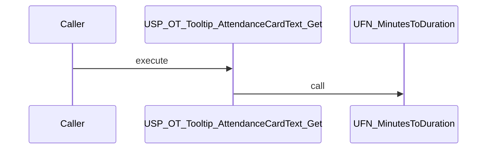
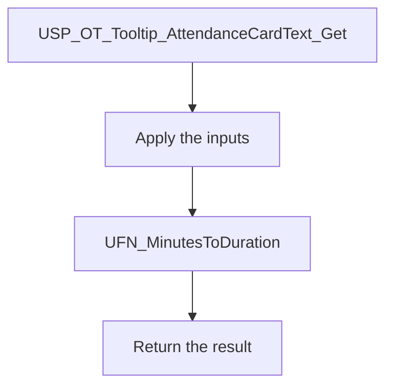

# USP_OT_Tooltip_AttendanceCardText_Get

## What it does

Called from the Home dashboard path. It reads OPENJSON, TAttendanceOverTimeRequest and returns the result to its caller.

## Parameters

| Name | Direction | What it is for |
|---|---|---|
| `@ScopeJSON` | in | Input used by this procedure (`NVARCHAR(MAX)`) |

## Call sequence

## Callers

| Object | Kind | Page |
|---|---|---|
| `SP_DB_EmployeeAttendanceDetails` | procedure | [SP_DB_EmployeeAttendanceDetails](/docs/database/hrms/SP_DB_EmployeeAttendanceDetails) |
| `SP_GetTeamAttendanceDetailsNew` | procedure | [SP_GetTeamAttendanceDetailsNew](/docs/database/hrms/SP_GetTeamAttendanceDetailsNew) |

## Nested

| Object | Kind | When | Page |
|---|---|---|---|
| `UFN_MinutesToDuration` | function | Called while this object runs | [UFN_MinutesToDuration](/docs/database/hrms/UFN_MinutesToDuration) |

## Steps

In `HRMS-DATABASE/HRMS/STOREPROCEDURE/USP_OT_Claim_AttendanceCardText_Get.sql`:

1. Read through `UFN_MinutesToDuration`.
2. Read `OPENJSON`, `TAttendanceOverTimeRequest`.
3. Return the result set to the caller.

## Tables

| Table | Read or write |
|---|---|
| `OPENJSON` | read |
| `TAttendanceOverTimeRequest` | read |

## Flow

