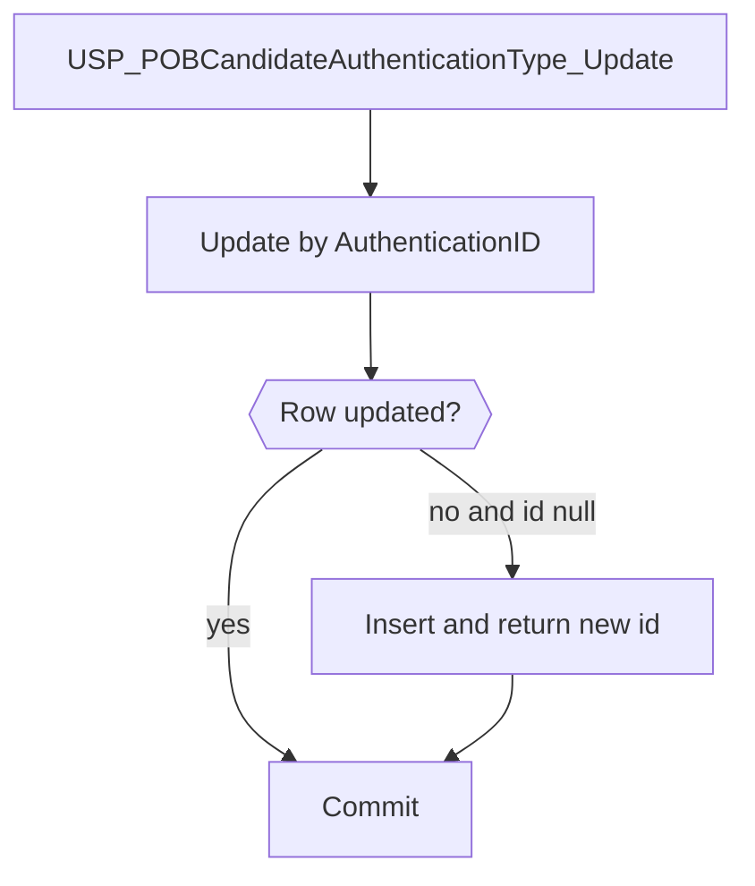

# USP_POBCandidateAuthenticationType_Update

## What it does

Updates an authentication type by id, or inserts a new row when the update matched nothing and `@AuthenticationID` is null. Runs inside a try/catch transaction.

## Parameters

| Name | Direction | What it is for |
|---|---|---|
| `@AuthenticationID` | in/out | Existing id to update; set on insert |
| `@EmployerID` | in | Employer |
| `@AuthenticationName` | in | Display name |
| `@IsActive` | in | Active flag |
| `@CreatedBy` | in | Creator on insert |
| `@ModifiedBy` | in | Modifier on update |

## Call sequence

Calls no other procedures or functions.

## Callers

No other procedure or function calls this object.

## Nested

Calls no other procedures or functions.

## Steps

1. Begin a transaction.
2. Update `POBCandidateAuthenticationType` for `@AuthenticationID`.
3. When no row was updated and `@AuthenticationID` is null, insert a new row and set `@AuthenticationID` from `SCOPE_IDENTITY()`.
4. Commit when the transaction state is committable; roll back on error and rethrow.

## Tables

| Table | Read or write |
|---|---|
| `POBCandidateAuthenticationType` | write |

## Flow

