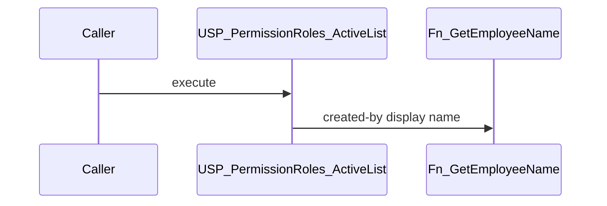
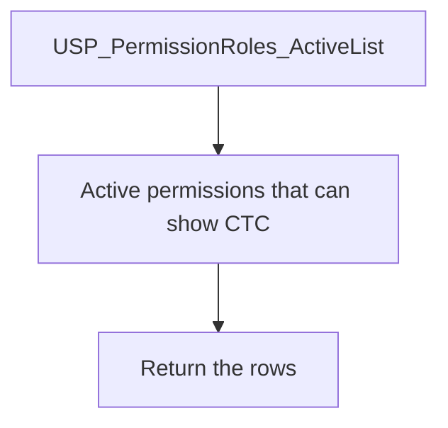

# USP_PermissionRoles_ActiveList

## What it does

Returns role CTC permissions for one employer that are active and allowed to show CTC. Recruitment Management uses this list as the role dropdown on the employee CTC panel.

## Parameters

| Name | Direction | What it is for |
|---|---|---|
| `@EmployerID` | in | Organisation |
| `@EmployeeID` | in | Accepted and unused in the statements |

## Call sequence

## Callers

No other procedure or function calls this object.

`dashBoardDAL.GetRoleListRecruitmentCTCSetup` calls it from Recruitment Management.

## Nested

| Object | Kind | When | Page |
|---|---|---|---|
| `Fn_GetEmployeeName` | function | once per row, for `CreatedBy` | [Fn_GetEmployeeName](/docs/database/hrms/Fn_GetEmployeeName) |

## Steps

1. Select the same permission, role, module, and employer columns as the full list (`USP_PermissionRoles_ActiveList.sql`).
2. Keep rows where `CanShowCTC` is 1 and `IsActive` is 1 for `@EmployerID`.

## Tables

| Table | Read or write |
|---|---|
| `TPermission` | read |
| `TRoles` | read |
| `THRMSModules` | read |
| `TEmployerDetails` | read |

## Flow

