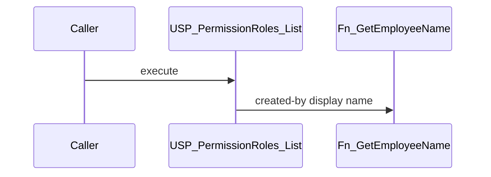
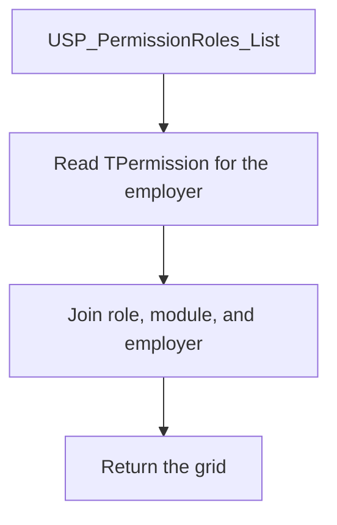

# USP_PermissionRoles_List

## What it does

Returns the role CTC-permission grid for one employer, with role name, module name, employer name, and the name of the person who created the row.

## Parameters

| Name | Direction | What it is for |
|---|---|---|
| `@EmployerID` | in | Organisation whose permissions are listed |
| `@EmployeeID` | in | Accepted and unused in the statements |

## Call sequence

## Callers

No other procedure or function calls this object.

`recruitmentDAL.GetPermissionRolesList` calls it from Recruitment Management.

## Nested

| Object | Kind | When | Page |
|---|---|---|---|
| `Fn_GetEmployeeName` | function | once per row, for `CreatedBy` | [Fn_GetEmployeeName](/docs/database/hrms/Fn_GetEmployeeName) |

## Steps

1. Select distinct permission, role, module, CTC flag, active flag, and employer from `TPermission` (`USP_PermissionRoles_List.sql`).
2. Join `TRoles` on role id where the role's employer matches or is 0, `THRMSModules` on module id, and `TEmployerDetails` on employer id.
3. Keep rows for `@EmployerID` and order by `PermissionID` descending.
4. Label `IsActive` 1 as `Active` and every other value as `InActive`.

## Tables

| Table | Read or write |
|---|---|
| `TPermission` | read |
| `TRoles` | read |
| `THRMSModules` | read |
| `TEmployerDetails` | read |

## Flow

