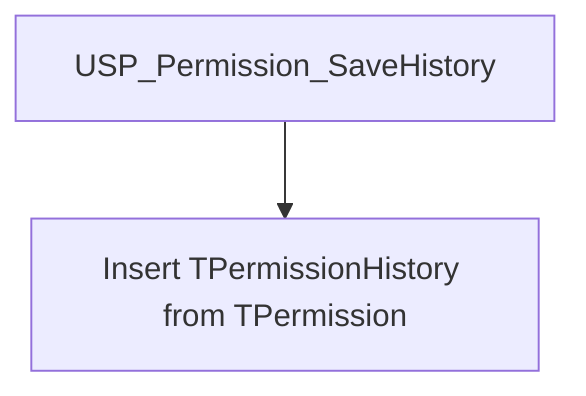

# USP_Permission_SaveHistory

## What it does

Copies the current `TPermission` row into `TPermissionHistory`.

## Parameters

| Name | Direction | What it is for |
|---|---|---|
| `@PermissionID` | in | Permission row to copy |

## Call sequence

Calls no other procedures or functions.

## Callers

| Object | Kind | Page |
|---|---|---|
| `USP_Permission_SaveUpdate` | procedure | [USP_Permission_SaveUpdate](/docs/database/hrms/USP_Permission_SaveUpdate) |
| `USP_Permission_Delete` | procedure | No page yet |

## Nested

Calls no other procedures or functions.

## Steps

1. Insert into `TPermissionHistory` the claim, employer, module, role, CTC flag, active flag, and audit columns from `TPermission` where `PermissionID` matches (`USP_Permission_SaveHistory.sql`).

## Tables

| Table | Read or write |
|---|---|
| `TPermission` | read |
| `TPermissionHistory` | write |

## Flow

