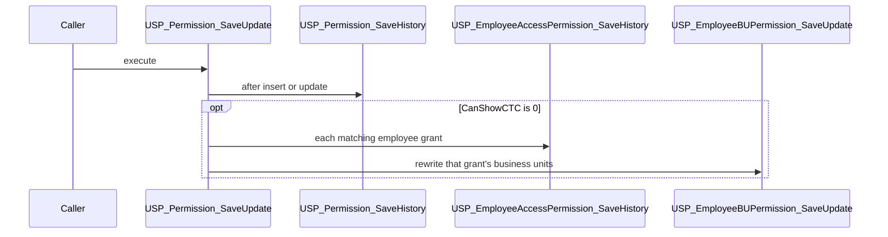
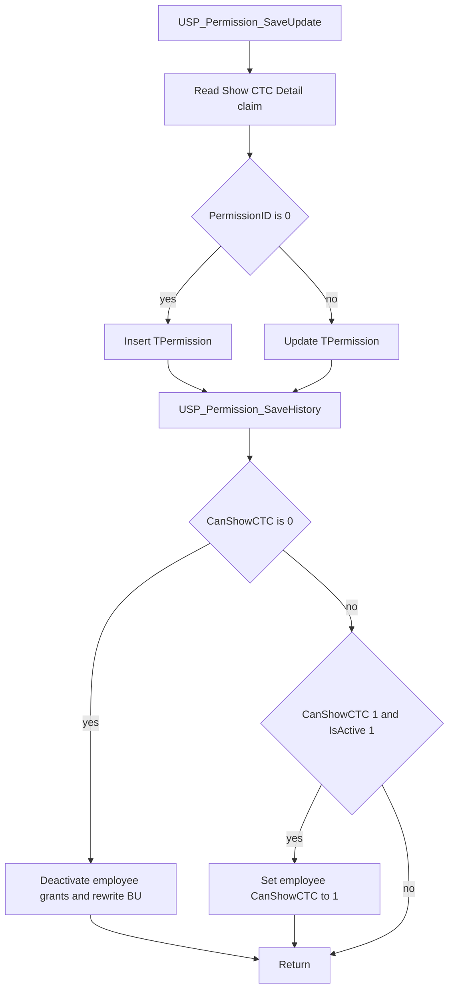

# USP_Permission_SaveUpdate

## What it does

Inserts or updates one role permission for the recruitment claim whose text is `Show CTC Detail`. It always writes a history row. When `@CanShowCTC` is 0 it also turns off active employee grants for that role and employer. When `@CanShowCTC` is 1 and `@IsActive` is 1 it turns those employee grants back on.

## Parameters

| Name | Direction | What it is for |
|---|---|---|
| `@EmployerID` | in | Organisation |
| `@PermissionID` | in | 0 inserts. Any other value updates that row |
| `@ModuleID` | in | Module on the permission |
| `@RoleID` | in | Role that may see CTC |
| `@CanShowCTC` | in | Whether the role can see CTC |
| `@CreatedBy` | in | Actor. Also stored as `UpdatedBy` on update |
| `@IsActive` | in | Active flag |

## Call sequence

## Callers

No other procedure or function calls this object.

`recruitmentDAL.InsertUpdateRolesPermission` calls it from Recruitment Management.

## Nested

| Object | Kind | When | Page |
|---|---|---|---|
| `USP_Permission_SaveHistory` | procedure | after the insert or update | [USP_Permission_SaveHistory](/docs/database/hrms/USP_Permission_SaveHistory) |
| `USP_EmployeeAccessPermission_SaveHistory` | procedure | when `@CanShowCTC` is 0, once per matching employee grant | [USP_EmployeeAccessPermission_SaveHistory](/docs/database/hrms/USP_EmployeeAccessPermission_SaveHistory) |
| `USP_EmployeeBUPermission_SaveUpdate` | procedure | same branch, after each employee history row | [USP_EmployeeBUPermission_SaveUpdate](/docs/database/hrms/USP_EmployeeBUPermission_SaveUpdate) |

## Steps

1. Read `RecruitmentClaimID` from `TRecruitmentClaim` where `RecruitmentClaimText` is `Show CTC Detail` (`USP_Permission_SaveUpdate.sql`).
2. When `@PermissionID` is null or 0, insert `TPermission` and set `@PermissionID` from `@@IDENTITY`.
3. Otherwise update that `TPermission` row's employer, module, role, CTC flag, active flag, and audit columns.
4. `EXEC USP_Permission_SaveHistory`.
5. When `@CanShowCTC` is 0, collect `TEmployeeAccessPermission` rows for the role and employer that are active or still show CTC, set `CanShowCTC` and `IsActive` to 0, and for each id call the employee history and business-unit procedures.
6. When `@CanShowCTC` is 1 and `@IsActive` is 1, set `CanShowCTC` to 1 on employee rows for that role and employer that are inactive or hidden.

## Tables

| Table | Read or write |
|---|---|
| `TRecruitmentClaim` | read |
| `TPermission` | write |
| `TEmployeeAccessPermission` | read and write |
| `TEmployeeBUPermission` | read, for the comma-separated business-unit list |

## Flow

