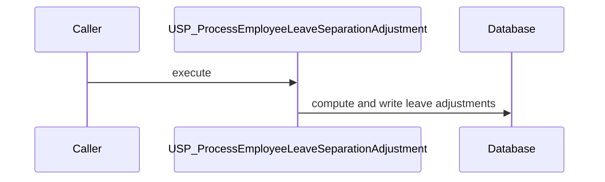
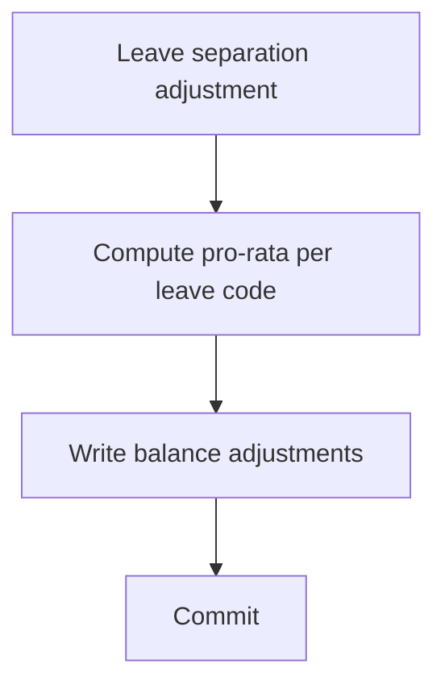

# USP_ProcessEmployeeLeaveSeparationAdjustment

## What it does

On deactivation, calculates pro-rata leave adjustments for the employee’s leave codes using cycle entitlement, worked days, round-off, and calendar settings, then writes the resulting balance adjustments inside a transaction.

## Parameters

| Name | Direction | What it is for |
|---|---|---|
| `@EmployeeId` | in | Employee being separated |
| `@EmployerId` | in | Employer |
| `@LastWorkingDate` | in | Last working date |
| `@DeactivationDate` | in | Deactivation date (defaults to today) |
| `@ModifiedBy` | in | Actor |
| `@IsDebug` | in | Debug output flag |

## Call sequence

## Callers

Nested from `SP_SEP_DeActivateEmployee_BY_ID` on successful deactivate.

## Nested

None required for the Search Employee nest depth (leave tables updated directly).

## Steps

1. Script is `HRMS-DATABASE/HRMS/STOREPROCEDURE/USP_ProcessEmployeeLeaveSeparationAdjustment.sql`.
2. Begin transaction; resolve calendar and leave policy inputs for the employee.
3. For applicable leave codes, compute pro-rata credit/adjustment from cycle dates and last working date.
4. Persist adjustments and commit (rollback on error with `XACT_ABORT`).

## Tables

| Table | Read or write |
|---|---|
| `dbo.TEmployeeInfo` | read |
| Leave balance / policy tables used by the script | read and write |

## Flow

