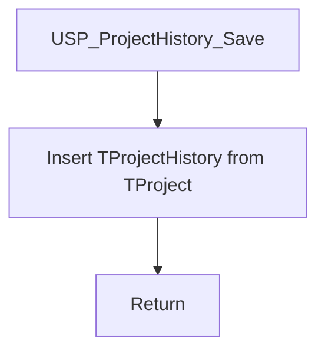

# USP_ProjectHistory_Save

## What it does

Copies the current `TProject` row for `@ProjectID` into `TProjectHistory`.

## Parameters

| Name | Direction | What it is for |
|---|---|---|
| `@ProjectID` | in | Project whose current row is snapshotted |

## Call sequence

Calls no other procedures or functions.

## Callers

Procedures and functions that call this object.

| Object | Kind | Page |
|---|---|---|
| `USP_Project_SaveUpdate` | procedure | [USP_Project_SaveUpdate](/docs/database/hrms/USP_Project_SaveUpdate) |
| `Sp_RA_Delete_TLookup` | procedure | [Sp_RA_Delete_TLookup](/docs/database/hrms-resourceallocation/Sp_RA_Delete_TLookup) |

## Nested

Calls no other procedures or functions.

## Steps

1. Script is `HRMS-DATABASE/HRMS/STOREPROCEDURE/USP_ProjectHistory_Save.sql`.
2. Insert into `TProjectHistory` selecting matching columns from `TProject` where `ProjectID = @ProjectID`.

## Tables

| Table | Read or write |
|---|---|
| `dbo.TProject` | read |
| `dbo.TProjectHistory` | write |

## Flow

