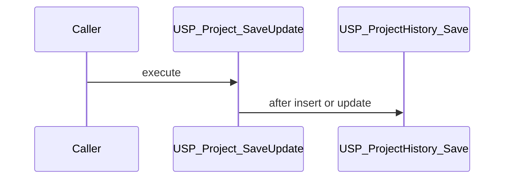
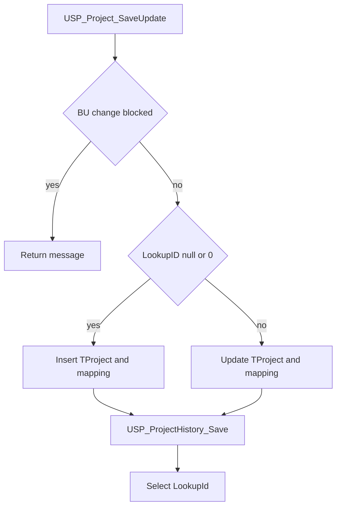

# USP_Project_SaveUpdate

## What it does

Inserts or updates a `TProject` master row and maintains `TClientProjectMapping` when `@SubParentId` (client) is supplied. On update, blocks primary-BU changes when Task Handoff is enabled and the project still has active tasks. Always writes `TProjectHistory` via `USP_ProjectHistory_Save` and returns `LookupId` (`ProjectID`).

## Parameters

| Name | Direction | What it is for |
|---|---|---|
| `@LookupID` | in | Project id; 0/null means insert |
| `@LookupText` | in | Project name |
| `@LookupParentId` | in | Expected project parent (2000) from caller |
| `@LookupBUs` | in | Passed through; stored on project fields in insert path |
| `@SubParentId` | in | Client id for `TClientProjectMapping` |
| `@pEmployerid` | in | Employer |
| `@AdditionalInfo` | in | Extra text |
| `@CreatedBy` | in | Actor |
| `@PrimaryBuID` | in | Primary project business unit |
| `@ParentProjectID` | in | Optional parent project |

## Call sequence

## Callers

Procedures and functions that call this object.

| Object | Kind | Page |
|---|---|---|
| `Sp_RA_InsertUpdate_TLookup` | procedure | [Sp_RA_InsertUpdate_TLookup](/docs/database/hrms-resourceallocation/Sp_RA_InsertUpdate_TLookup) |

Also reachable from Resource Allocation via synonym `ResourceAllocation.dbo.USP_Project_SaveUpdate`.

## Nested

| Object | Kind | When | Page |
|---|---|---|---|
| `USP_ProjectHistory_Save` | procedure | after every successful save | [USP_ProjectHistory_Save](/docs/database/hrms/USP_ProjectHistory_Save) |

## Steps

1. Script is `HRMS-DATABASE/HRMS/STOREPROCEDURE/USP_Project_SaveUpdate.sql`.
2. On update, if primary BU would change and Task Handoff is active with open tasks, return a message and stop.
3. If `@LookupID` is 0/null, insert `TProject` and optional `TClientProjectMapping`.
4. Else update `TProject` and adjust client-project mapping when `@SubParentId` is set.
5. `EXEC USP_ProjectHistory_Save` for the project id.
6. Select `@ProjectID AS LookupId`.

## Tables

| Table | Read or write |
|---|---|
| `dbo.TProject` | read and write |
| `dbo.TClientProjectMapping` | write |
| `dbo.TWM_TAccessGroupPermissions` | read |
| `dbo.TWM_Task` | read |
| `dbo.TProjectHistory` | write via nested save |

## Flow

