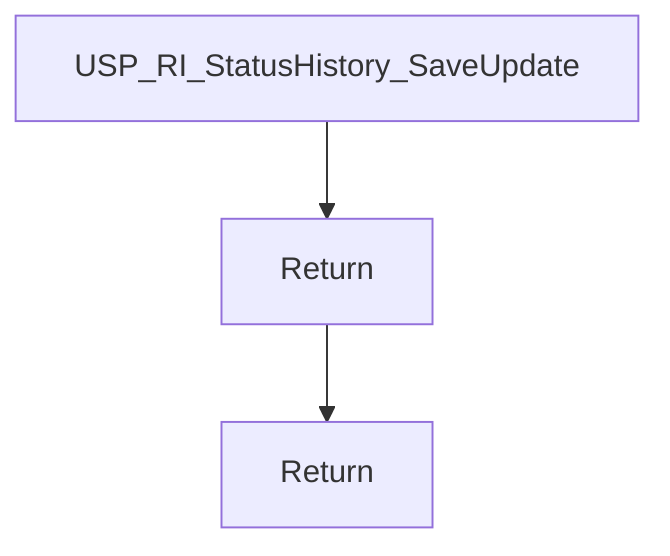

# USP_RI_StatusHistory_SaveUpdate

## What it does

Stored procedure `USP_RI_StatusHistory_SaveUpdate`. Calls no other procedure or function. Touches no clearly parsed tables.

## Parameters

| Name | Direction | What it is for |
|---|---|---|
| *(none parsed / table-valued only)* | — | See script |

## Call sequence

Calls no other procedures or functions.

## Callers

No other procedure or function calls this object.

## Nested

Calls no other procedures or functions.

## Steps

1. Script is `HRMS-DATABASE/HRMS/STOREPROCEDURE/USP_RI_StatusHistory_SaveUpdate.sql`.

## Tables

| Table | Read or write |
|---|---|
| *(none parsed)* | — |

## Flow

