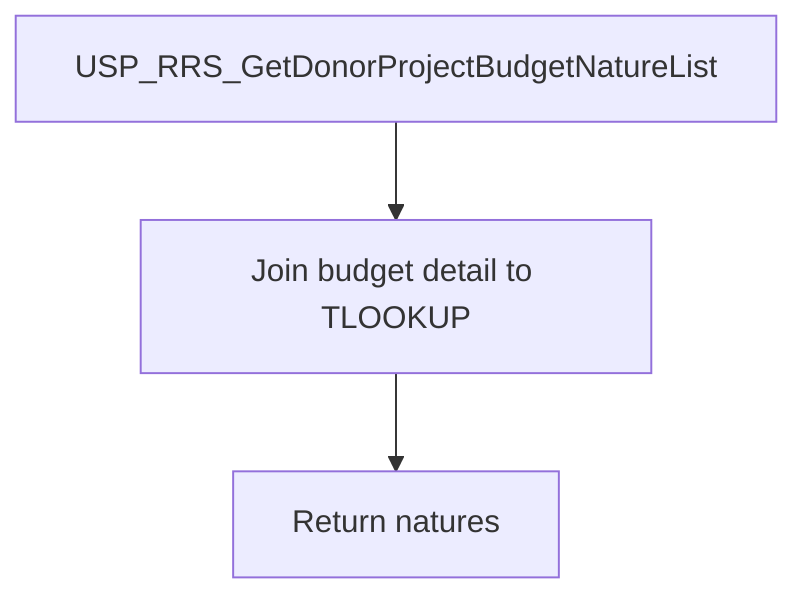

# USP_RRS_GetDonorProjectBudgetNatureList

## What it does

Lists distinct budget expense-nature lookup values for active donor budgets filtered by optional donor and project id lists. Labels come from `TLOOKUP` parent `15000`.

## Parameters

| Name | Direction | What it is for |
|---|---|---|
| `@DonarId` | in | Comma-separated donor ids |
| `@ProjectID` | in | Comma-separated project ids |
| `@EmployerId` | in | Employer filter |

## Call sequence

Calls no other procedures or functions.

## Callers

Application: Donor Information Setup report filters `getDonorProjectBudgetNatureList` (`recruitmentDAL.js`). No other procedure or function calls this object.

## Nested

Calls no other procedures or functions.

## Steps

1. Join active `TDonorBudget` to `TDonorBudgetDetail`.
2. Join expense nature to `TLOOKUP` (`Lookup_Parent_ID = 15000`).
3. Filter by employer and optional donor/project `STRING_SPLIT` lists.

## Tables

| Table | Read or write |
|---|---|
| `TDonorBudget` | read |
| `TDonorBudgetDetail` | read |
| `TLOOKUP` | read |

## Unresolved calls

None.

## Flow

