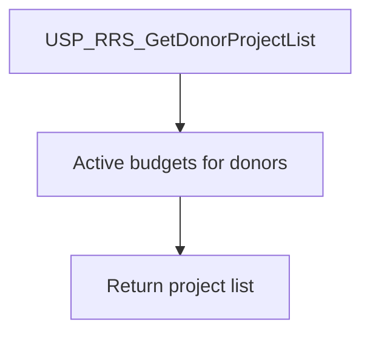

# USP_RRS_GetDonorProjectList

## What it does

Lists distinct projects that have an active budget (status on and today within budget dates) for the given donor id list and employer. Project names come from `TProject`.

## Parameters

| Name | Direction | What it is for |
|---|---|---|
| `@DonarId` | in | Comma-separated donor ids (optional empty = all) |
| `@EmployerId` | in | Employer filter |

## Call sequence

Calls no other procedures or functions.

## Callers

Application: Donor Information Setup report filters `getDonorProjectList` (`recruitmentDAL.js`). Also usable from other RRS donor consumers. No procedure nests this object.

## Nested

Calls no other procedures or functions.

## Steps

1. Select distinct `ProjectID` / `ProjectName` from `TDonorBudget` joined to `TProject`.
2. Restrict to employer, optional donor list via `STRING_SPLIT`, and currently active budget window.

## Tables

| Table | Read or write |
|---|---|
| `TDonorBudget` | read |
| `TProject` | read |

## Unresolved calls

None.

## Flow

