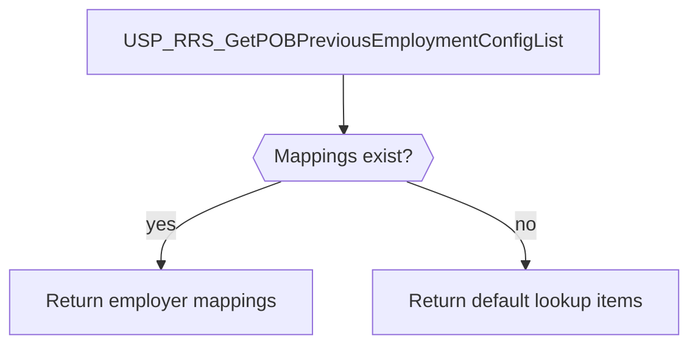

# USP_RRS_GetPOBPreviousEmploymentConfigList

## What it does

Returns previous-employment document configuration for an employer and lookup id. If employer mappings exist, those rows are returned. Otherwise default lookup items are returned.

## Parameters

| Name | Direction | What it is for |
|---|---|---|
| `@EmployerId` | in | Employer |
| `@POBLookupid` | in | Lookup category, typically previous employment |

## Call sequence

Calls no other procedures or functions.

## Callers

No other procedure or function calls this object.

## Nested

Calls no other procedures or functions.

## Steps

1. When `POBLookupEmployerMapping` already has rows for the employer and lookup id, return those active mapped items joined to `POBLookupItems`.
2. Otherwise return default active `POBLookupItems` for the lookup id with zeroed mapping id and comment or review flags.

## Tables

| Table | Read or write |
|---|---|
| `POBLookupEmployerMapping` | read |
| `POBLookupItems` | read |

## Flow

