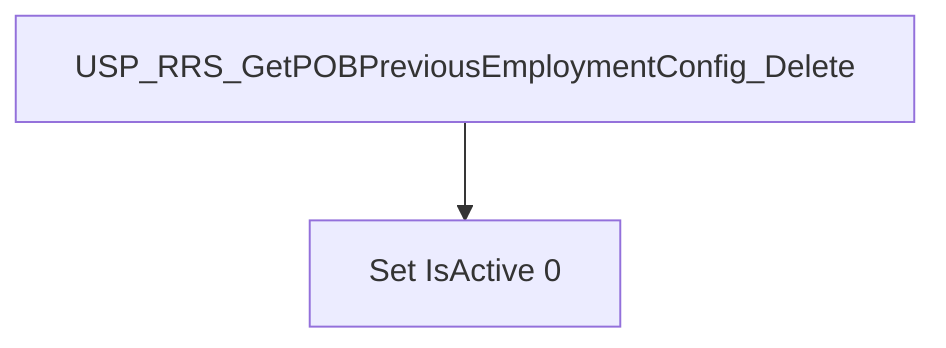

# USP_RRS_GetPOBPreviousEmploymentConfig_Delete

## What it does

Soft-deactivates one previous-employment employer mapping by setting `IsActive` to 0.

## Parameters

| Name | Direction | What it is for |
|---|---|---|
| `@POBLookupEmployerMappingID` | in | Mapping to deactivate |
| `@UpdatedBy` | in | User who deactivated the row |

## Call sequence

Calls no other procedures or functions.

## Callers

No other procedure or function calls this object.

## Nested

Calls no other procedures or functions.

## Steps

1. When `@POBLookupEmployerMappingID` is not 0, update `POBLookupEmployerMapping` to `IsActive` 0 and stamp updater and updated time.

## Tables

| Table | Read or write |
|---|---|
| `POBLookupEmployerMapping` | write |

## Flow

