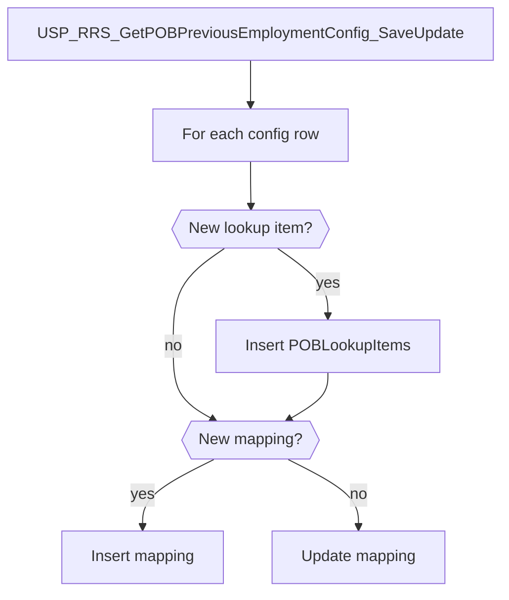

# USP_RRS_GetPOBPreviousEmploymentConfig_SaveUpdate

## What it does

Saves previous-employment configuration rows from a table-valued parameter. New lookup items are inserted when needed, then employer mappings are inserted or updated one row at a time.

## Parameters

| Name | Direction | What it is for |
|---|---|---|
| `@EmployerID` | in | Employer |
| `@ConfigList` | in | `UDT_POBPreviousEmployment` rows |
| `@Createdby` | in | Creator for new rows |
| `@UpdatedBy` | in | Updater for existing mappings |

## Call sequence

Calls no other procedures or functions.

## Callers

No other procedure or function calls this object.

## Nested

Calls no other procedures or functions.

## Steps

1. Copy `@ConfigList` into a temp table with row numbers when the list is not empty.
2. For each row, insert into `POBLookupItems` when `POBLookupItemsID` is 0.
3. Insert into `POBLookupEmployerMapping` when mapping id is 0; otherwise update the existing mapping.

## Tables

| Table | Read or write |
|---|---|
| `POBLookupItems` | write |
| `POBLookupEmployerMapping` | write |

## Flow

