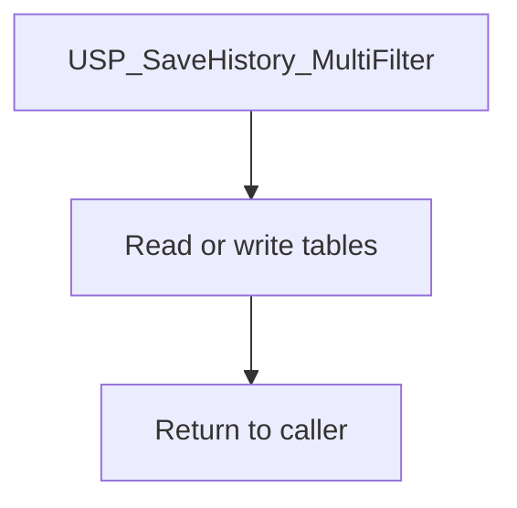

# USP_SaveHistory_MultiFilter

## What it does

To Maintain History with multiple filters

## Parameters

| Name | Direction | What it is for |
|---|---|---|
| `@DBName` | in | SYSNAME |
| `@MainTableName` | in | SYSNAME |
| `@HistoryTableName` | in | SYSNAME |
| `@FilterColumns` | in | VARCHAR(MAX) |
| `@FilterValues` | in | VARCHAR(MAX) |
| `@HistoryCreatedBy` | in | INT (default NULL) |
| `@HistoryCreatedDate` | in | DATETIME |
| `@ActionType` | in | CHAR(1) |

## Call sequence

Calls no other procedures or functions.

## Callers

No other procedure or function in the Master Question Bank direct set calls this object.

Application code may call it through `masterQuestionBankDAL`.

## Nested

Calls no other procedures or functions.

## Steps

1. Inserts into the target table(s) listed under Tables.

## Tables

| Table | Read or write |
|---|---|
| `sys` | read |
| `STRING_SPLIT` | read |
| `Rows` | read |
| `Parsed` | read |

## Unresolved calls

Uses `sp_executesql` for dynamic SQL. The object names built in the string are not resolved here.

## Flow

