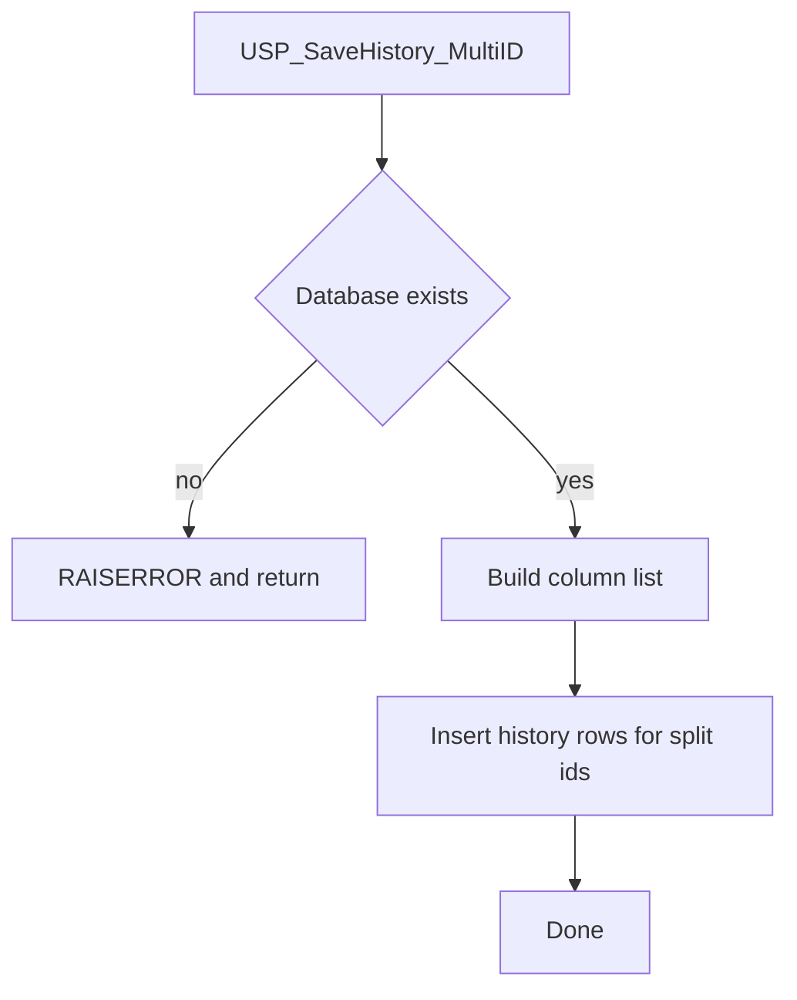

# USP_SaveHistory_MultiID

## What it does

Copies one or more rows from a main table into a history table in a named database, adding `HistoryCreatedBy`, `HistoryCreatedDate`, and `ActionType`. Conference Room Booking Permission Setup reaches it through the CRB synonym when `Usp_CRB_InsertClaimsByRole` records an insert into `TCLAIM_ASSIGNMENT_History`.

## Parameters

| Name | Direction | What it is for |
|---|---|---|
| `@DBName` | in | Target database name (`DB_NAME()` from the caller) |
| `@MainTableName` | in | Source table name only |
| `@HistoryTableName` | in | History table name only |
| `@ID` | in | Primary-key column name |
| `@Value` | in | One id or comma-separated ids |
| `@HistoryCreatedBy` | in | Optional history actor id |
| `@HistoryCreatedDate` | in | History timestamp |
| `@ActionType` | in | History action code (`I` on CRB claim insert) |

## Call sequence

Calls no other user procedures or functions. Uses `sp_executesql` and `STRING_SPLIT` for dynamic column lists and multi-id filters.

## Callers

Procedures and functions that call this object.

| Object | Kind | Page |
|---|---|---|
| `Usp_CRB_InsertClaimsByRole` | procedure | [Usp_CRB_InsertClaimsByRole](/docs/database/hrms-crbbooking/Usp_CRB_InsertClaimsByRole) |

App callers reach it only through nested CRB claim insert on [Conference Room Booking Permission Setup](/docs/guides/admin-configuration/conference-room-booking-permission-setup). Other modules may call it as well via the HRMS procedure or synonyms.

## Nested

Calls no other user procedures or functions.

## Steps

1. Script is `HRMS-DATABASE/HRMS/STOREPROCEDURE/USP_SaveHistory_MultiID.sql`.
2. Validate `@DBName` exists.
3. Build the main-table column list from `sys.columns` in that database.
4. Insert into the history table selecting matching main-table rows for the split `@Value` ids, plus history metadata.

## Tables

| Table | Read or write |
|---|---|
| Caller-supplied main table | read |
| Caller-supplied history table | write |
| `sys.databases` / `sys.columns` | read (metadata) |

For this screen the concrete tables are CRB `TCLAIM_ASSIGNMENT` (read) and `TCLAIM_ASSIGNMENT_History` (write).

## Unresolved calls

None.

## Flow

