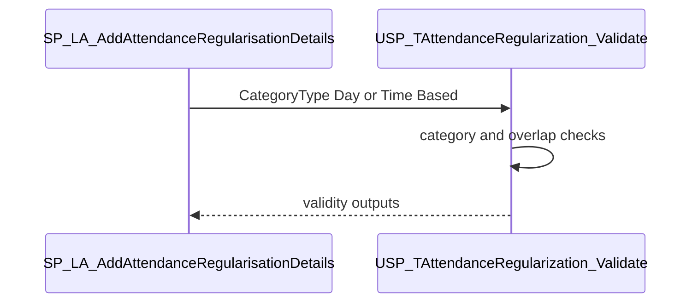
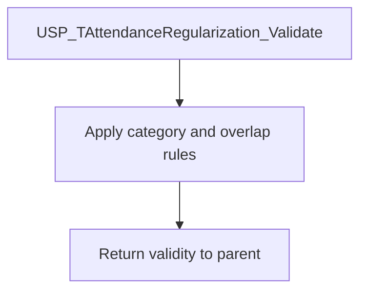

# USP_TAttendanceRegularization_Validate

## What it does

Day-based or time-based AR validation nested from `SP_LA_AddAttendanceRegularisationDetails`. Checks category rules, overlapping requests, and duration constraints before the AR insert commits.

## Parameters

Category type and AR date/time context are passed from the parent AR insert (see script for the full parameter list). `@CategoryType` distinguishes `Day Based` vs `Time Based` call sites.

## Call sequence

## Callers

| Object | Kind | Page |
|---|---|---|
| `SP_LA_AddAttendanceRegularisationDetails` | procedure | [SP_LA_AddAttendanceRegularisationDetails](/docs/database/hrms/SP_LA_AddAttendanceRegularisationDetails) |

## Nested

Inspect script for further EXECs; none required for the L&A Tasks one-level pass beyond this object.

## Steps

1. Script is `HRMS-DATABASE/HRMS/STOREPROCEDURE/USP_TAttendanceRegularization_Validate.sql`.
2. Validate AR category applicability and overlaps for the requested window.
3. Return validity messaging to the parent insert.

## Tables

| Table | Read or write |
|---|---|
| `TAttendanceRegularization` | read |
| AR category / attendance tables | read |

## Unresolved calls

Further nested helpers inside the validate script are not expanded here.

## Flow

