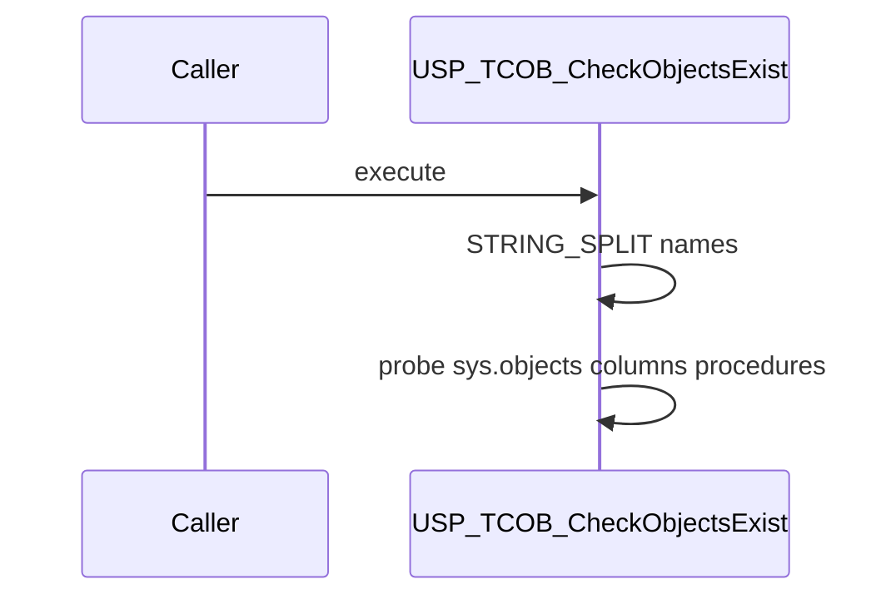
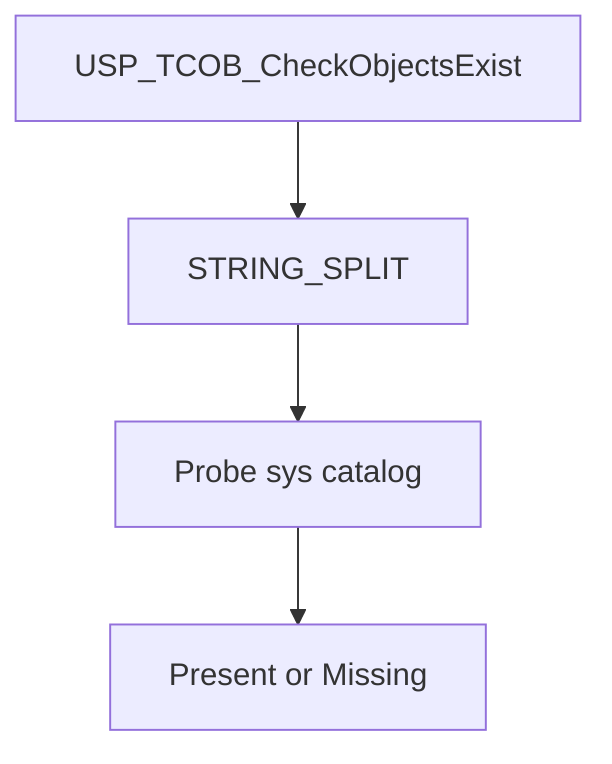

# USP_TCOB_CheckObjectsExist

## What it does

Validates a comma-separated list of object names against the current database catalog. Names with a dot are checked as `Table.Column`; bare names as table/view; all names are also checked as stored procedures. Returns each name with `ObjectType` (COLUMN / TABLE / STORED_PROCEDURE / NOT FOUND) and Status Present or Missing.

## Parameters

| Name | Type | Direction | Default | Meaning |
|---|---|---|---|---|
| `@ObjectNames` | NVARCHAR(MAX) | in | — | Comma-separated names |

## Call sequence

Calls no other procedures or functions.

## Callers

Procedures and functions that call this object.

No other procedure or function calls this object. App caller: `ClientOnboardingDAL.verifyDbColumn` from Config Manager (`POST /api/clientonboard2/cfg/verifyDbColumn`).

## Nested

| Object | Kind | When | Page |
|---|---|---|---|
| *(none)* | — | — | — |

## Steps

1. Script is `HRMS-DATABASE/HRMS/STOREPROCEDURE/USP_TCOB_CheckObjectsExist.sql`.
2. Split `@ObjectNames` on commas.
3. For each name, classify as column, table/view, or procedure via `sys.*`.

## Tables

| Table | Read or write |
|---|---|
| `sys.objects` | read |
| `sys.columns` | read |
| `sys.procedures` | read |

## Unresolved calls

None.

## Flow

