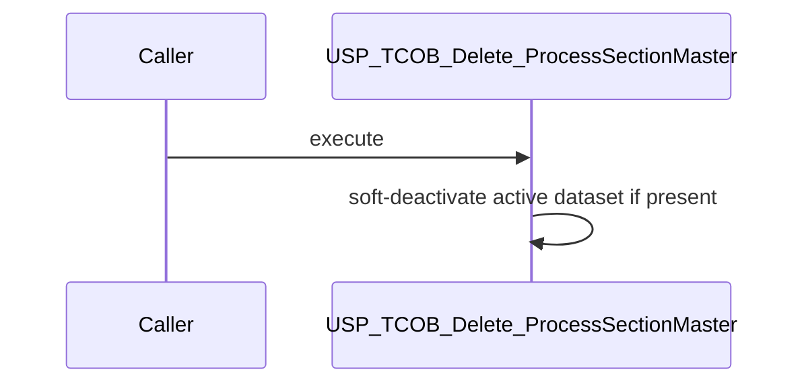
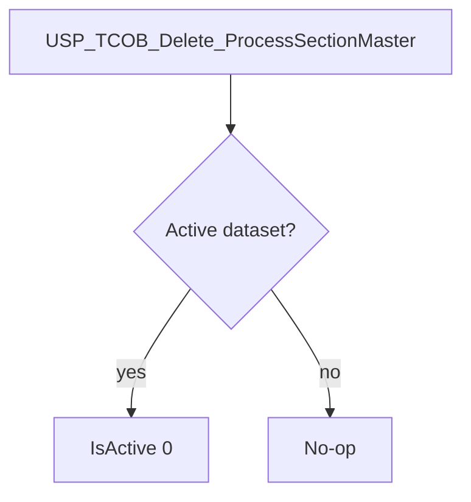

# USP_TCOB_Delete_ProcessSectionMaster

## What it does

Soft-deactivates one Config Manager dataset by setting `IsActive = 0` on an active `TCOB_ProcessSectionMaster` row. No-op when already inactive or missing.

## Parameters

| Name | Type | Direction | Default | Meaning |
|---|---|---|---|---|
| `@SectionID` | INT | in | — | Dataset to deactivate |
| `@EmployeeID` | INT | in | — | Audit user |

## Call sequence

Calls no other procedures or functions.

## Callers

Procedures and functions that call this object.

No other procedure or function calls this object. App caller: `ClientOnboardingDAL.deleteTCOBProcessSectionMaster` from Config Manager (`POST /api/clientonboard2/cfg/deleteProcessSectionMaster`).

## Nested

| Object | Kind | When | Page |
|---|---|---|---|
| *(none)* | — | — | — |

## Steps

1. Script is `HRMS-DATABASE/HRMS/STOREPROCEDURE/USP_TCOB_Delete_ProcessSectionMaster.sql`.
2. If an active dataset exists, set `IsActive = 0` and audit columns.

## Tables

| Table | Read or write |
|---|---|
| `dbo.TCOB_ProcessSectionMaster` | read + write |

## Unresolved calls

None.

## Flow

