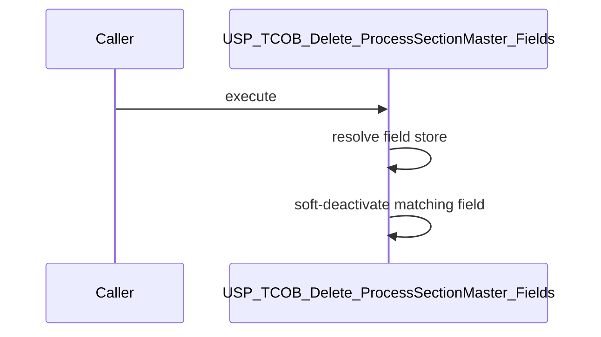
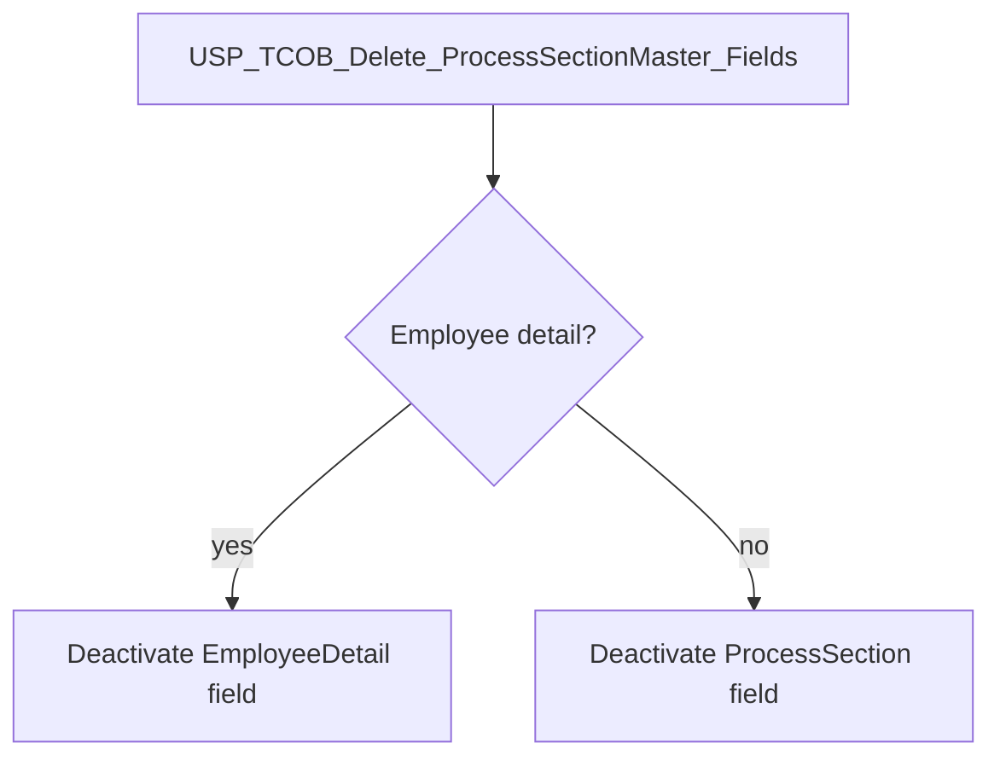

# USP_TCOB_Delete_ProcessSectionMaster_Fields

## What it does

Soft-deactivates one Config Manager field by name for a dataset. Uses `TCOB_EmployeeDetail_Fields` when the dataset is employee-detail backed; otherwise `TCOB_ProcessSectionMaster_Fields`. Sets `IsActive = 0` and clears `IsPublished` on the matched active field.

## Parameters

| Name | Type | Direction | Default | Meaning |
|---|---|---|---|---|
| `@SectionID` | INT | in | — | Parent dataset |
| `@FieldName` | NVARCHAR(500) | in | — | Field to deactivate |
| `@EmployeeID` | INT | in | — | Audit user |

## Call sequence

Calls no other procedures or functions.

## Callers

Procedures and functions that call this object.

No other procedure or function calls this object. App caller: `ClientOnboardingDAL.deleteTCOBProcessSectionMasterFields` from Config Manager (`POST /api/clientonboard2/cfg/deleteProcessSectionMasterFields`).

## Nested

| Object | Kind | When | Page |
|---|---|---|---|
| *(none)* | — | — | — |

## Steps

1. Script is `HRMS-DATABASE/HRMS/STOREPROCEDURE/USP_TCOB_Delete_ProcessSectionMaster_Fields.sql`.
2. Resolve employee-detail vs process-section field store.
3. Soft-deactivate the active field matching `@FieldName` (case-insensitive).

## Tables

| Table | Read or write |
|---|---|
| `dbo.TCOB_ProcessSectionMaster` | read |
| `dbo.TCOB_EmployeeDetail_Fields` | write (employee-detail path) |
| `dbo.TCOB_ProcessSectionMaster_Fields` | write (default path) |

## Unresolved calls

None.

## Flow

