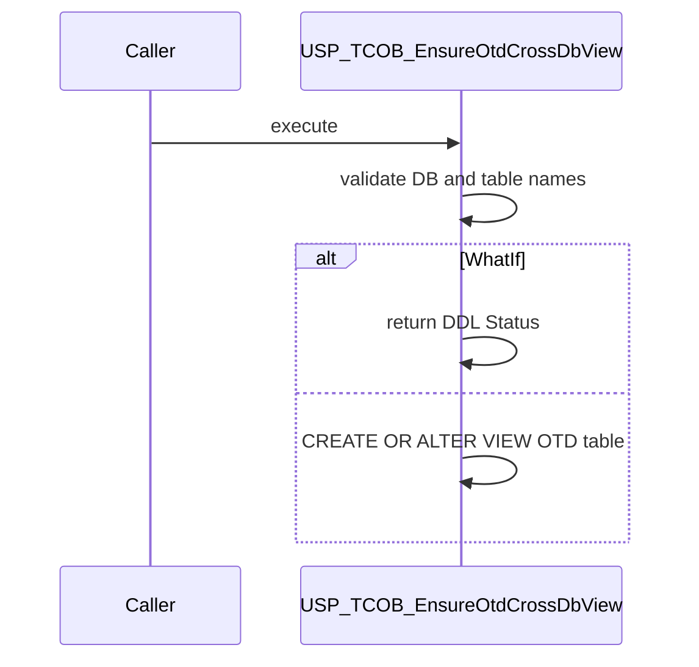
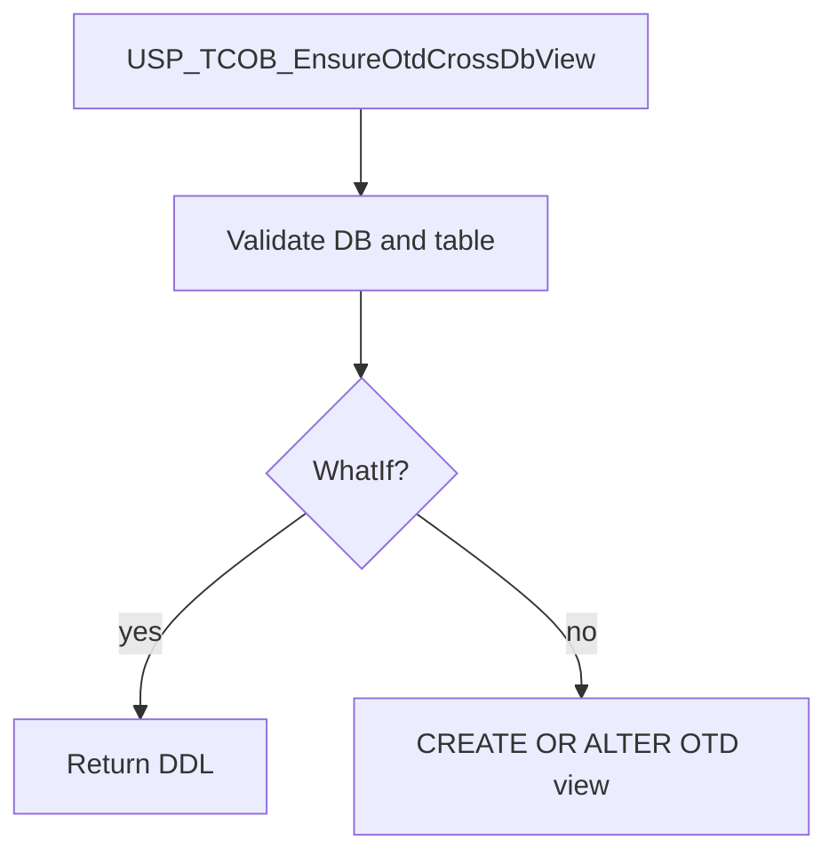

# USP_TCOB_EnsureOtdCrossDbView

## What it does

Creates or refreshes a local view `dbo.OTD{TableName}` over a table in another database on the same instance so Config Manager / OTD seeding and `USP_COB_MasterProcessor` can insert via a one-part name. Validates `@DBName` against `sys.databases` before dynamic SQL. `@WhatIf = 1` returns planned DDL without changing objects. Refuses when the target is the current database or identifiers are invalid.

## Parameters

| Name | Type | Direction | Default | Meaning |
|---|---|---|---|---|
| `@DBName` | SYSNAME | in | — | Remote database |
| `@TableName` | SYSNAME | in | — | Plain remote table name (OTD prefix added) |
| `@WhatIf` | BIT | in | 0 | 1 = return DDL only |

## Call sequence

Calls no other procedures or functions (emits dynamic `CREATE OR ALTER VIEW` only).

## Callers

Procedures and functions that call this object.

No other procedure or function calls this object. App caller: `ClientOnboardingDAL.ensureOtdCrossDbView` from Config Manager (`POST /api/clientonboard2/cfg/ensureCrossDbView`).

## Nested

| Object | Kind | When | Page |
|---|---|---|---|
| *(none)* | — | — | — |

## Steps

1. Script is `HRMS-DATABASE/HRMS/STOREPROCEDURE/USP_TCOB_EnsureOtdCrossDbView.sql`.
2. Validate identifiers and that `@DBName` is a real non-system database other than current.
3. Build `OTD` + table view DDL; apply unless `@WhatIf = 1`.
4. Return ViewName, Status, Message, DDL.

## Tables

| Table | Read or write |
|---|---|
| `sys.databases` | read |
| remote `INFORMATION_SCHEMA` / columns (dynamic) | read |
| `dbo.OTD*` view | write (CREATE OR ALTER) |

## Unresolved calls

None.

## Flow

