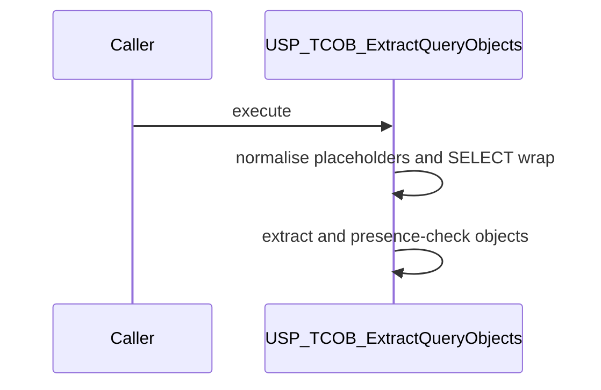
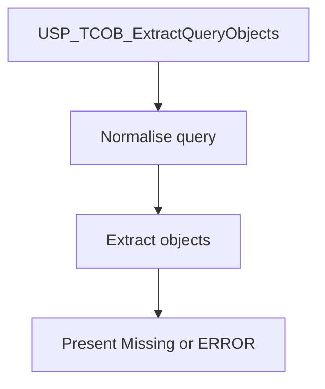

# USP_TCOB_ExtractQueryObjects

## What it does

Parses a Config Manager SQL snippet (validation / transformation rule) and reports referenced tables, columns, and related objects with presence flags. Substitutes `@{…}` placeholders with NULL, wraps bare expressions as `SELECT (…)`, then uses SQL Server metadata helpers to extract objects. Returns ERROR-typed rows when compilation fails.

## Parameters

| Name | Type | Direction | Default | Meaning |
|---|---|---|---|---|
| `@Query` | NVARCHAR(MAX) | in | — | SQL or expression to analyse |

## Call sequence

Calls no other procedures or functions (uses catalog / dynamic metadata inside the script).

## Callers

Procedures and functions that call this object.

No other procedure or function calls this object. App caller: `ClientOnboardingDAL.validateSqlSnippet` from Config Manager verify path (`POST /api/clientonboard2/cfg/verifyDbColumn` when SQL snippets are supplied).

## Nested

| Object | Kind | When | Page |
|---|---|---|---|
| *(none)* | — | — | — |

## Steps

1. Script is `HRMS-DATABASE/HRMS/STOREPROCEDURE/USP_TCOB_ExtractQueryObjects.sql`.
2. Normalise `@Query` (placeholder swap, optional SELECT wrap).
3. Extract referenced objects and mark present/missing; emit ERROR rows on failure.

## Tables

| Table | Read or write |
|---|---|
| catalog / `sys.*` (in-script) | read |

## Unresolved calls

None.

## Flow

