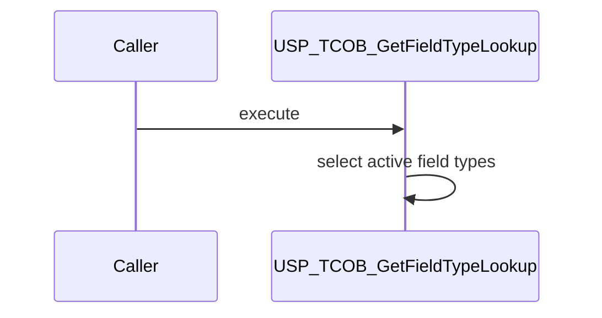
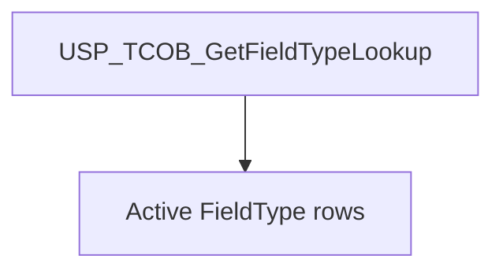

# USP_TCOB_GetFieldTypeLookup

## What it does

Returns active field-type lookup rows (`FieldTypeID`, `FieldType`) from `TFieldType_LookUp` for Config Manager field editors and COB config publish datatype inference.

## Parameters

None.

## Call sequence

Calls no other procedures or functions.

## Callers

Procedures and functions that call this object.

No other procedure or function calls this object. App caller: `ClientOnboardingDAL.getTCOBFieldTypeLookup` from Config Manager (`GET /api/clientonboard2/cfg/getFieldTypeLookup`) and nested from `generateCOBConfigFile`.

## Nested

| Object | Kind | When | Page |
|---|---|---|---|
| *(none)* | — | — | — |

## Steps

1. Script is `HRMS-DATABASE/HRMS/STOREPROCEDURE/USP_TCOB_GetFieldTypeLookup.sql`.
2. Select active rows from `TFieldType_LookUp` ordered by `FieldType`.

## Tables

| Table | Read or write |
|---|---|
| `dbo.TFieldType_LookUp` | read |

## Unresolved calls

None.

## Flow

