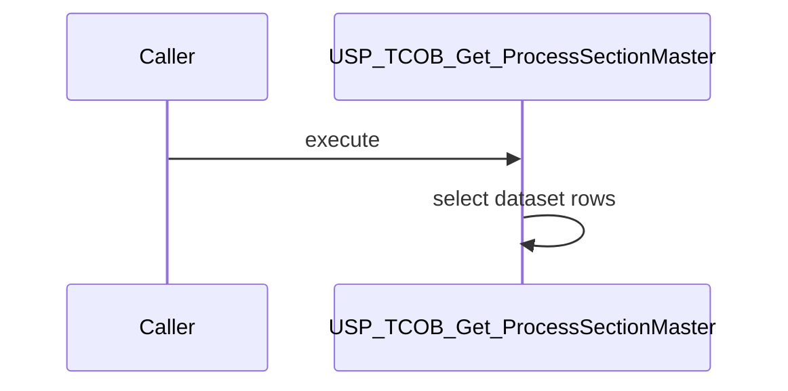
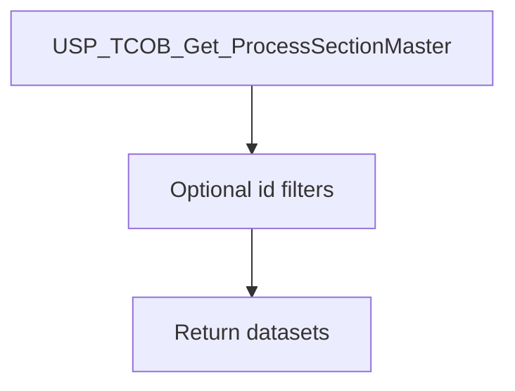

# USP_TCOB_Get_ProcessSectionMaster

## What it does

Returns Config Manager dataset rows from `TCOB_ProcessSectionMaster`, optionally filtered by template id, template-section id, and/or section id. Includes flags for master data, client onboarding data, industry scope, and optional cross-database `DB_Name`. Does not filter to `IsActive = 1` (inactive rows are returned).

## Parameters

| Name | Type | Direction | Default | Meaning |
|---|---|---|---|---|
| `@TemplateID` | INT | in | NULL | Filter by template |
| `@TemplateSectionID` | INT | in | NULL | Filter by sheet |
| `@SectionID` | INT | in | NULL | Filter by dataset |

## Call sequence

Calls no other procedures or functions.

## Callers

Procedures and functions that call this object.

No other procedure or function calls this object. App caller: `ClientOnboardingDAL.getTCOBProcessSectionMaster` from Config Manager (`GET /api/clientonboard2/cfg/getProcessSectionMaster`) and nested from `generateCOBConfigFile`.

## Nested

| Object | Kind | When | Page |
|---|---|---|---|
| *(none)* | — | — | — |

## Steps

1. Script is `HRMS-DATABASE/HRMS/STOREPROCEDURE/USP_TCOB_Get_ProcessSectionMaster.sql`.
2. Select dataset columns with optional filters; order by template, display order, section name.

## Tables

| Table | Read or write |
|---|---|
| `dbo.TCOB_ProcessSectionMaster` | read |

## Unresolved calls

None.

## Flow

