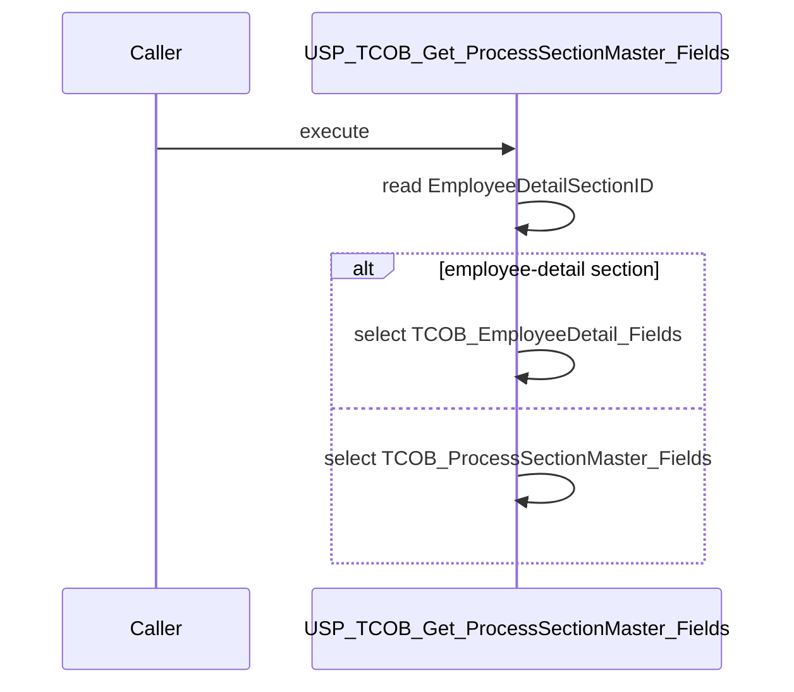
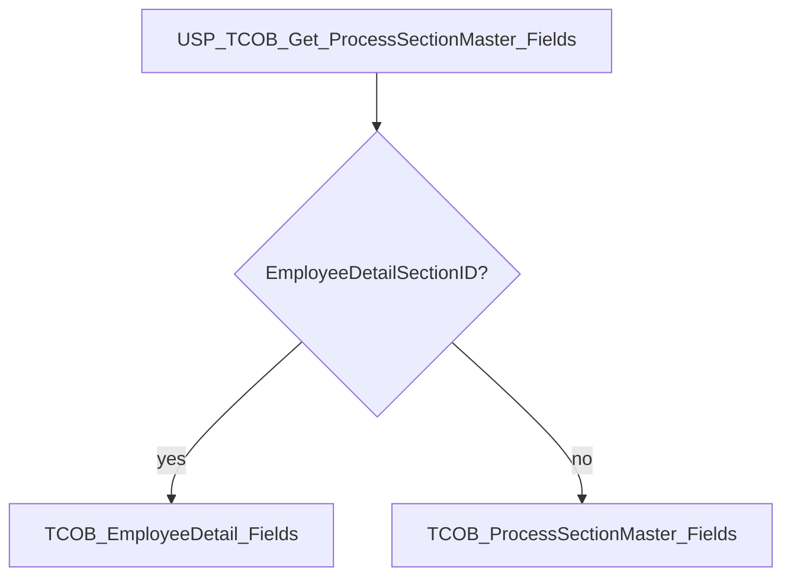

# USP_TCOB_Get_ProcessSectionMaster_Fields

## What it does

Returns field metadata for one Config Manager dataset. If the dataset maps to an employee-detail section (`EmployeeDetailSectionID`), rows come from `TCOB_EmployeeDetail_Fields` with `SourceTable = EmployeeDetail`. Otherwise rows come from `TCOB_ProcessSectionMaster_Fields` (process-section field store).

## Parameters

| Name | Type | Direction | Default | Meaning |
|---|---|---|---|---|
| `@SectionID` | INT | in | — | Process-section dataset id |

## Call sequence

Calls no other procedures or functions.

## Callers

Procedures and functions that call this object.

No other procedure or function calls this object. App caller: `ClientOnboardingDAL.getTCOBProcessSectionMasterFields` from Config Manager (`GET /api/clientonboard2/cfg/getProcessSectionMasterFields`) and nested from `generateCOBConfigFile`.

## Nested

| Object | Kind | When | Page |
|---|---|---|---|
| *(none)* | — | — | — |

## Steps

1. Script is `HRMS-DATABASE/HRMS/STOREPROCEDURE/USP_TCOB_Get_ProcessSectionMaster_Fields.sql`.
2. Look up `EmployeeDetailSectionID` for `@SectionID`.
3. Select from employee-detail fields or process-section fields accordingly.

## Tables

| Table | Read or write |
|---|---|
| `dbo.TCOB_ProcessSectionMaster` | read |
| `dbo.TCOB_EmployeeDetail_Fields` | read |
| `dbo.TCOB_ProcessSectionMaster_Fields` | read |

## Unresolved calls

None.

## Flow

