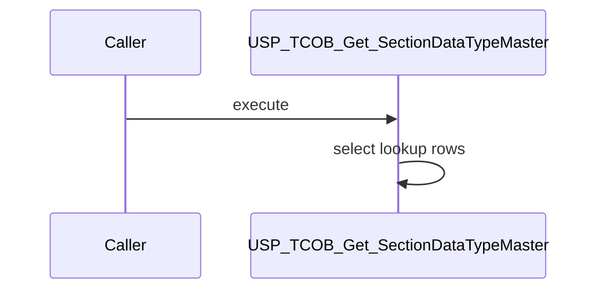
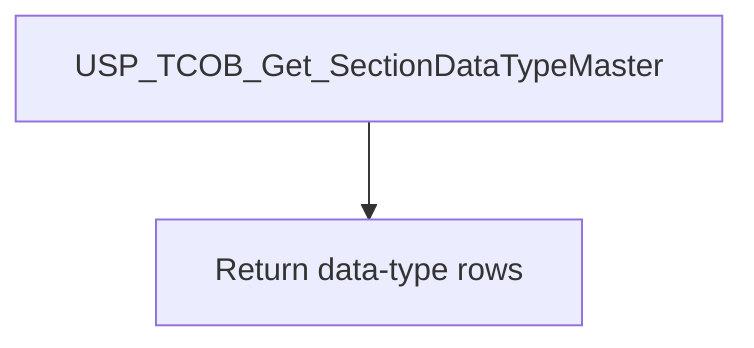

# USP_TCOB_Get_SectionDataTypeMaster

## What it does

Returns Config Manager section data-type lookup rows from `TCOB_SectionDataTypeMaster`, optionally filtered by id.

## Parameters

| Name | Type | Direction | Default | Meaning |
|---|---|---|---|---|
| `@SectionDataTypeID` | INT | in | NULL | Single type; NULL = all |

## Call sequence

Calls no other procedures or functions.

## Callers

Procedures and functions that call this object.

No other procedure or function calls this object. App caller: `ClientOnboardingDAL.getTCOBSectionDataTypeMaster` from Config Manager (`GET /api/clientonboard2/cfg/getSectionDataTypeMaster`).

## Nested

| Object | Kind | When | Page |
|---|---|---|---|
| *(none)* | — | — | — |

## Steps

1. Script is `HRMS-DATABASE/HRMS/STOREPROCEDURE/USP_TCOB_Get_SectionDataTypeMaster.sql`.
2. Select id and label with optional filter; order by id.

## Tables

| Table | Read or write |
|---|---|
| `dbo.TCOB_SectionDataTypeMaster` | read |

## Unresolved calls

None.

## Flow

